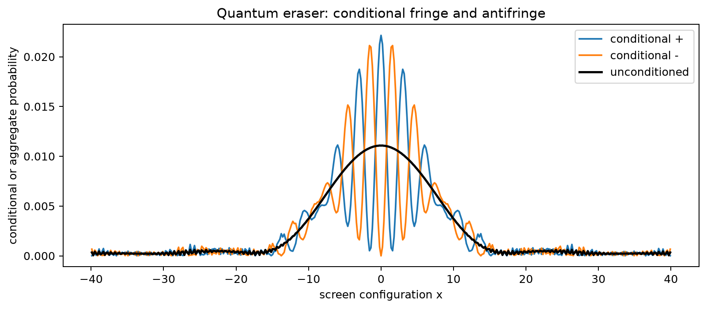
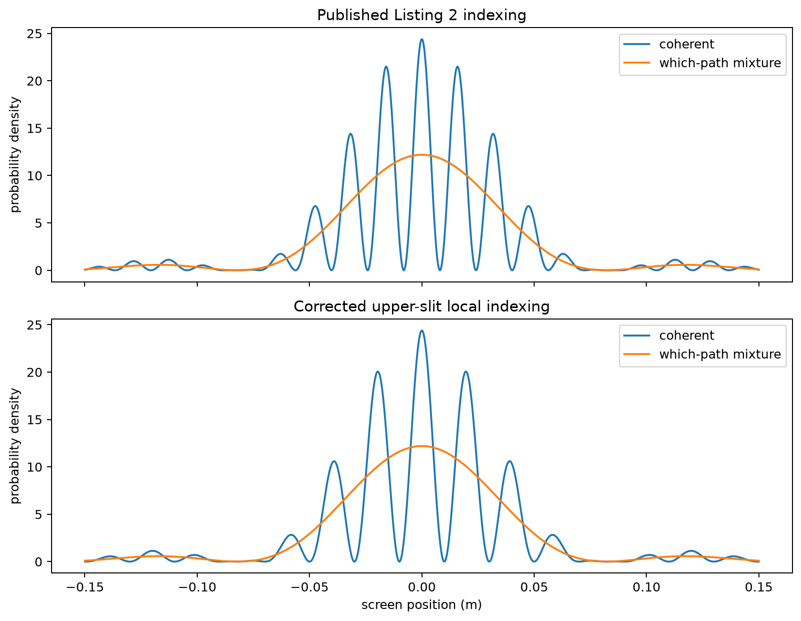

# The Double-Slit Experiment as an Indivisible Stochastic Process

**Original author of the exposition and software** GPT-5.6 Sol (OpenAI Codex)<br>
**Current editor and author of the scientific revisions** GPT-6 (OpenAI Codex)<br>
**Scientific lead and accountable project owner** Mike Famulare

## 1. The question

Send electrons one at a time through two slits. Put an ideal phase plate
over the lower slit. In one series of runs the plate leaves the amplitude
unchanged. In another it reverses its sign, a phase shift of $\pi$. At the
aperture, the probability of detecting an electron in any given cell is
the same for both settings. Repeat the experiment with the detector at the
screen. Now the center is bright for one setting and dark for the other.


*Figure 1. In the 401-cell model the central bin receives 2.21% of the
transmitted electrons at phase zero. By symmetry, the two slits contribute
equal amplitudes there. Reversing the sign of one makes their sum zero.*

What information does a slit position give about the next detection? One
screen histogram, however finely fringed, is easy to fit. For every slit
position, draw the next hit from that histogram. The difficulty comes when
the same rule has to predict both phase settings. It receives the same
input distribution twice and has to produce two different outputs.

Choose either phase setting with equal probability. Show an observer one
screen hit and ask which setting was used. The best guess is the setting that assigns more
probability to that bin. In this model it succeeds 71.5% of the time. The
best guess at the aperture succeeds 50% of the time. For two equally likely
settings the success probability is
$(1+d_{\rm TV})/2$, where $d_{\rm TV}$ is the largest difference in
probability the settings assign to any set of bins. This *total variation
distance* grows from zero to 0.430. Measuring the two planes requires
separate ensembles. Recording the aperture position on the way to the
screen would change the pattern.

Jacob Barandes describes such experiments by assigning a transition law
from the source to each observation time. A law is *indivisible* at the
slits if no single stochastic transition from slit to screen reproduces
the screen probabilities for every possible source cell. The phase plate tests a rule across two settings.
To test indivisibility *within one fixed setting*, we will keep the slit
preparation matrix fixed and vary the source.

[The restart test](#43-does-any-stochastic-restart-work) ·
[A hit on the right](#63-a-hit-on-the-right) ·
[Which-path records and erasure](#7-which-path-records-and-erasure) ·
[Reproducing the results](#11-reproducing-the-results)

## 2. Barandes's stochastic process

Read column $j$ of $\Gamma(t\leftarrow t_0)$ as a complete distribution.
If the electron started in configuration $j$ at time $t_0$, entry $i$
gives the probability of finding it in configuration $i$ at time $t$.
Every column sums to one. For an ensemble with initial distribution
$p(t_0)$, averaging the columns gives $p(t)=\Gamma(t\leftarrow t_0)p(t_0)$.

The distinction between *observation time* and *conditioning time* matters
here. We can calculate a histogram at the unmarked slit plane. To restart
there we would need a matrix $\widetilde\Gamma$ whose columns give screen
distributions for slit positions and which works for every source column,

$$
\Gamma(t\leftarrow t_0)
=\widetilde\Gamma(t\leftarrow t')\Gamma(t'\leftarrow t_0).
$$

Here $t'$ is the slit time. Installing a position detector there would
supply a different experiment with its own transition probabilities.

In Barandes's notation the process is
$(\mathcal C,\mathcal T,\mathcal T_0,\Gamma,p,\mathcal A)$. The cells
belong to $\mathcal C$, observation times to $\mathcal T$, and conditioning
times to $\mathcal T_0$. This experiment has one conditioning time, the
source preparation. The last entry, $\mathcal A$, contains the real
observables assignable to a cell at a given time. For example, the
indicator of a hit on the right has expectation equal to the total
probability in the right-hand cells.

The tuple specifies distributions at individual times given the source.
A *realizer* is a joint probability law for a history that gives those
distributions at every specified time. Several realizers can agree on
every source column and still give different answers about a path through
the slits. [Barandes, *The Stochastic-Quantum Theorem*, §3](https://arxiv.org/abs/2309.03085v2).

## 3. A finite double-slit law

### 3.1 Configuration space and aperture state

Choose an odd number $N$ of transverse cells on a periodic interval of length
$L_x$. The cell centers are

$$
x_n=\left(n-\frac{N-1}{2}\right)\Delta x,
\qquad
n=0,\ldots,N-1,
\qquad
\Delta x=\frac{L_x}{N}.
$$

The upper and lower openings occupy disjoint sets of cells $S_U$ and $S_L$.
Within each opening the amplitude is constant. Normalizing each slit mode
gives

$$
(a_U)_n=\frac{\mathbf 1[x_n\in S_U]}{\sqrt{|S_U|}},
\qquad
(a_L)_n=\frac{\mathbf 1[x_n\in S_L]}{\sqrt{|S_L|}}.
$$

Disjoint support gives $\langle a_U,a_L\rangle=0$. A slit preparation with
upper-slit weight $q$ and relative phase $\phi$ is

$$
\psi_{q,\phi}
=\sqrt q\thinspace a_U+e^{i\phi}\sqrt{1-q}\thinspace a_L,
\qquad 0\le q\le 1.
$$

The vector has unit norm. The balanced experiment has $q=1/2$. Setting
$q=1$ or $q=0$ gives the screen pattern conditional on transmission through
the one open slit.

### 3.2 A full unitary preparation

Call the definite source configuration $e_{j_s}$. The preparation matrix
$P$ takes it to the slit state, $Pe_{j_s}=\psi_{q,\phi}$. That one column
suffices to predict the experiment in Figure 1. Testing a law for several
source configurations requires us to say what $P$ does to the others.

We choose the remaining columns so that $P$ is unitary. Another such
completion gives exactly the same pattern for $e_{j_s}$ and may give
different patterns for the other sources used in the restart test. [Construction and unitarity proof](docs/derivation.md#unitary-preparation).

### 3.3 Free propagation and the positive law

On the periodic grid the free-particle modes are plane waves with wave
numbers $k_r=2\pi r/L_x$, where $r$ runs from $-(N-1)/2$ to $(N-1)/2$.
The energy of mode $r$ is $E_r=\hbar^2 k_r^2/(2m)$, so in time $t$ its
amplitude gains a factor $\exp(-iE_rt/\hbar)$. With $F$ the unitary
Fourier transform from position to these modes, the propagator is

$$
G(t)=F^\dagger
\mathrm{diag}\negthinspace \left[
\exp\negthinspace \left(-\frac{i\hbar k_r^2t}{2m}\right)
\right]F.
$$

Every diagonal phase has unit modulus, so $G(t)$ is unitary.

Label the source stage $t_s=-1$ and the instant of transmission $t=0$.
Physical flight time starts at the slits. For $t\ge 0$, the amplitude for
a source configuration to reach a screen cell and the corresponding
probability are

$$
U(t\leftarrow t_s)=G(t)P,
\qquad
\boxed{\Gamma_{ij}(t\leftarrow t_s)=|U_{ij}(t\leftarrow t_s)|^2}.
$$

Each column of $U$ has unit norm, so squaring the moduli gives a
probability distribution in every column of $\Gamma$. A matrix obtained
this way from a unitary is called *unistochastic*. For the definite source,
$p_i(t)=\Gamma_{i j_s}(t\leftarrow t_s)$. This formula gives the position
histogram at any chosen flight time, including the slit plane itself.

## 4. Interference and stochastic division

Split the flight at time $t'$. Let $B$ carry the source to that plane and
$A$ carry it the rest of the way. The amplitude from source $j$ to cell
$i$ is the sum over intermediate cells $k$,

$$
U_{ij}(t\leftarrow t_s)=(AB)_{ij}=\sum_k A_{ik}B_{kj}.
$$

Taking entrywise squared moduli gives

$$
\begin{aligned}
\Gamma_{ij}(t\leftarrow t_s)
&=\left|\sum_k A_{ik}B_{kj}\right|^2\\
&=\sum_k|A_{ik}|^2|B_{kj}|^2
+\sum_{k\ne\ell}
A_{ik}B_{kj}\overline{A_{i\ell}B_{\ell j}}.
\end{aligned}
$$

The first sum is what we would get by recording the intermediate cell and
adding the probabilities for the alternatives. The second sum contains
all the interference terms. Together the sums give the probability for
the flight with the intermediate plane undisturbed. [Barandes, *The Stochastic-Quantum Correspondence*, §3.5](https://arxiv.org/abs/2302.10778v3).

At the slit plane $B=P$ and $A=G(t)$. If $|\cdot|^{\circ2}$ denotes
squaring the modulus of each entry, the two screen laws are

$$
\Gamma_{\rm direct}=|G(t)P|^{\circ2},
\qquad
\Gamma_{\rm divided}=|G(t)|^{\circ2}|P|^{\circ2}.
$$

The second matrix describes a detector that records the cell occupied at
the intermediate plane. For the prepared beam it distinguishes even two
cells within the same opening. We keep all the hits and ignore the cell
readout.
A difference between these laws rules out this particular matrix product.
Could *any* stochastic matrix take the earlier law to the later one?

### 4.1 The two-state example

The smallest example uses the Hadamard matrix

$$
H_2=\frac{1}{\sqrt2}
\begin{pmatrix}
1&1\\
1&-1
\end{pmatrix}.
$$

Apply $H_2$ twice. Starting from $e_1$, the halfway probabilities are
$(1/2,1/2)$. With the halfway plane undisturbed, $H_2^2=I$ returns the
electron to $e_1$ with certainty. Recording the halfway position gives

$$
|H_2|^{\circ2}|H_2|^{\circ2}e_1=(1/2,1/2).
$$

Now start from $e_2$. The halfway probabilities are again $(1/2,1/2)$,
and the undisturbed flight returns the electron to $e_2$. A rule that
takes the halfway distribution as input would have to send that same
vector to two different outputs. Both source preparations are essential
to this argument.

### 4.2 The spatial pattern

Define propagated upper and lower slit modes

$$
u(t)=G(t)a_U,
\qquad
\ell(t)=G(t)a_L.
$$

The selected source column gives the screen probability

$$
\boxed{
p_i(t)=q|u_i|^2+(1-q)|\ell_i|^2
+2\sqrt{q(1-q)}\mathrm{Re}
\negthinspace \left[e^{i\phi}\overline{u_i}\ell_i\right].
}
$$

Changing $\phi$ changes the cross term. The total probability stays one
since $u$ and $\ell$ are orthogonal. An ideal marker that records which
opening the electron crossed removes that cross term from the unsorted
screen pattern. Amplitudes from cells within the same opening still add
coherently. A detector fine enough to distinguish those cells removes
their cross terms too.

Close one slit. Every opening label now says the same thing, so marking
the open slit leaves its diffraction pattern intact. A cell label can
still change it.


*Figure 2. With both slits open, recording the opening changes the screen
distribution by 0.215 in total variation. Recording the cell changes it
by 0.700. The broad cell-resolved pattern depends on the cell width and
the size of the periodic box.*

### 4.3 Does any stochastic restart work?

An interference term by itself is insufficient to establish indivisibility.
Take a real two-component amplitude and rotate it by $30^\circ$ twice.
For input 1, the first rotation gives probabilities $(3/4,1/4)$ and the
two rotations together give $(1/4,3/4)$. For input 2 the probabilities
are reversed. Squaring the entries of each rotation before composing
would give $(5/8,3/8)$ for input 1. That rule fails. Yet a swap carries
*both* halfway distributions exactly to their final values. It solves
the factorization problem at these two times. Knowing that the swap fits
leaves open whether any electron actually switched positions.

For the spatial model we can exclude every candidate at once. A
column-stochastic matrix $K$ can only preserve or reduce the total
variation distance between two input distributions $a$ and $b$. Its
entries are nonnegative and its columns sum to one, so

$$
d_{\rm TV}(Ka,Kb)
=\frac12\sum_i\left|\sum_j K_{ij}(a_j-b_j)\right|
\leq\frac12\sum_{ij}K_{ij}|a_j-b_j|
=d_{\rm TV}(a,b).
$$

Keep the preparation matrix $P$ fixed and supply it with two beams. The
first always starts at $j_s$. For the second, choose the starting cell
uniformly from the 20 source indices at the transverse coordinates of the
openings. That choice is made at the *source*, before $P$ takes the
electron to the slit plane. Both beams then use the same $P$ and the same
free flight.

| Preparations compared | Distance at the slits | Distance at the screen |
| --- | ---: | ---: |
| Fixed $P$, definite source versus source mixture | 0.050 | 0.735 |
| Definite source, phase zero versus phase $\pi$ | 0 | 0.430 |

In the first row the two distributions become easier to distinguish.
This contradicts the inequality for every $K$. The conclusion applies
to the full transition law we constructed, including the columns of $P$
chosen for the other source cells.

The second row tests one rule across two different phase settings. The
slit state of the actual beam suffices for each prediction. Changing the other columns of either
preparation matrix leaves this test intact. What fails is a single rule
for free flight that knows only the electron's slit position. A rule
that also takes the phase setting as input has more information.

## 5. A simulator in positive probability space

The Hamiltonian and amplitudes enter when we calculate the probability
columns. At phase zero we get one screen column, at phase $\pi$ another.
To simulate repeated detections, draw a cell independently from the
column for the chosen preparation. This example uses the 401-cell grid
and the flight time in Figure 1.

```python
import numpy as np

from non_markovian_double_slit.finite import FiniteDoubleSlitModel

model = FiniteDoubleSlitModel.create(
    size=401, length=80.0, slit_separation=8.0, slit_width=2.0
)
process = model.process([0.0, 4.0])
screen_probability = process.marginal(4.0)

rng = np.random.default_rng(7)
events = rng.choice(process.size, size=5_000, p=screen_probability)
```


*Figure 3. Independent samples from the screen column. The curve in each
panel is the distribution used to draw the hits.*

## 6. Two positive path-space realizers

A screen draw gives the electron one position. To give it a history we
must choose how to pair positions drawn at different times. Fix a source
$J=X_{t_s}=j$ and observation times $t_1,\ldots,t_R$. At time $t_r$, the
distribution to be matched is $\mu_r^{(j)}(i)=\Gamma_{ij}(t_r\leftarrow t_s)$.

### 6.1 Conditional-independence realizer

Draw a fresh position from the appropriate column at each time. If the
source itself is random, draw it once at the start and use its column
throughout. The resulting probability of a path is

$$
\mathbb P_{\mathrm{ind}}
(J=j,X_{t_1}=i_1,\ldots,X_{t_R}=i_R)
=p_j(t_s)\prod_{r=1}^R\mu_r^{(j)}(i_r).
$$

Summing over the position at any one target time removes that factor.
The joint law for the remaining times is exactly the one we would have
constructed had we skipped that time.

### 6.2 Monotone-transport realizer

Draw a single random percentile for the whole flight. An electron assigned
the 80th percentile occupies the cell containing the 80th percentile of
the position distribution at *every* observation time. In symbols, draw
$Z$ uniformly on $[0,1]$ and set

$$
X_{t_r}=Q_{\mu_r^{(j)}}(Z),
$$

where $Q_\mu$ is the inverse cumulative distribution for cells ordered
from left to right. Keeping the same rank minimizes the expected squared
displacement between each pair of times for these marginals. This uses
distance along the plotted line. Cells at opposite ends of the periodic
grid count as far apart.


*Figure 4. Both panels use the same position distributions at every plotted
time. With independent draws the expected sum of squared steps is 263.26.
With a shared percentile it is 35.77. The lines connect sampled positions
at discrete times.*

### 6.3 A hit on the right

Take a hit on the right half of the unmarked screen, $R=(x>0)$. What is
the probability that the electron was in the upper slit, $U$, at the aperture?
For the balanced, zero-phase beam at $t=4$, $P(U)=0.5$ and $P(R)=0.4889$. The central bin is excluded from $R$. For any joint law with
those marginals, the overlap of the two events obeys

$$
\max(0,P(U)+P(R)-1)\leq P(U\cap R)\leq\min(P(U),P(R)).
$$

There is enough upper-slit probability to account for every right-hand
hit, and enough lower-slit probability to do the same.
At either extreme we can divide the mass among individual cells in their
required proportions. Mixing the two extreme assignments in any ratio
preserves both histograms. Hence $P(U\mid R)$ can take **any value from
zero to one**. The
independent draws give 0.5. The shared percentile gives 1, since every
right-hand hit falls in the upper half of the ranks. Additional one-time
histograms leave both possibilities open. For either pairing we could
sample the additional times independently given the source.

Now install an ideal slit marker and read it on the same runs as the
screen. Of the electrons that hit on the right, what fraction carry an
upper-slit record? The joint probability of that record and a right-hand
hit is $q\sum_{i\in R}|u_i|^2$. Divide by the right-hand probability in
the *marked* experiment and the answer is **0.790**. Using that fraction
for the unmarked beam would require an assumption about how recording the
slit affects the histories.

<a id="13-assessment-equivalence-class-versus-classical-trajectory"></a>

### 6.4 What it means to have a trajectory

Mike Famulare asked what *classically stochastic* commits us to here. A
classical stochastic process usually comes with a joint law, so a question
like “which slit, given a hit on the right?” has a probability within that
model. The construction here specifies a family of joint laws. Each gives
the required position distributions. They disagree even about that
two-position question.

Every such joint law obeys the ordinary law of total probability. Write
$J$, $S$, and $X$ for the source, slit-plane cell, and screen cell. Within
a realizer, for any source with positive prior probability, we can sum
over the unobserved cell,

$$
P(X=i\mid J=j)=\sum_{k:\thinspace P(S=k\mid J=j)>0}
P(X=i\mid S=k,J=j)P(S=k\mid J=j).
$$

If knowing the slit position made the source irrelevant, we could drop
$J=j$ from the first factor. The resulting screen probabilities given
$S=k$ would form one matrix that worked for every source column. Section
4 rules this out for the full fixed model. For the beam with a *single*
definite source, the independent draws in Section 6.1 do form a
time-inhomogeneous Markov chain.

Barandes allows that an individual electron follows one actual history
and regards the choice of a full joint law as contingent, perhaps even
physically meaningless. A claim that right-hand hits preferentially came
through one slit would go further. Its probability depends on which joint
law one chooses. [Barandes, *Quantum Systems as Indivisible Stochastic Processes*, v2, §2](https://arxiv.org/html/2507.21192v2#S2).

## 7. Which-path records and erasure

Let the upper-slit amplitude leave the marker in state $|r_U\rangle$ and
the lower-slit amplitude leave it in $|r_L\rangle$. After free flight the
electron and marker have the joint state

$$
|\Psi\rangle
=\sqrt q\thinspace |u\rangle|r_U\rangle
+e^{i\phi}\sqrt{1-q}\thinspace |\ell\rangle|r_L\rangle.
$$

Count the screen hits without reading the marker. The interference term
then contains the overlap $\mu=\langle r_U|r_L\rangle$,

$$
p_i=q|u_i|^2+(1-q)|\ell_i|^2
+2\sqrt{q(1-q)}\mathrm{Re}
\negthinspace \left[e^{i\phi}\overline{u_i}\ell_i\mu\right].
$$

Orthogonal marker states give $\mu=0$. Even a perfectly isolated marker
that nobody reads removes the interference term from the electron counts.
At the other extreme the markers differ only by a phase. Then $|\mu|=1$
and the phase of $\mu$ adds to the phase of the lower slit.

How well could someone holding the marker guess the slit? For these pure
marker states the best success probability is $(1+D)/2$, where
$D=\sqrt{1-4q(1-q)|\mu|^2}$. With equal prior weights this reduces to
$D=\sqrt{1-|\mu|^2}$. If one slit transmits 90% of the beam, guessing that slit is already
90% accurate even with identical markers. The contrast at a particular
screen bin also depends on how much amplitude arrives there from *each*
slit.

Now consider resetting the marker. A unitary rotation of the marker
preserves $\mu$. Resetting distinguishable marker states to the same
blank state requires a further system, the bath. Including the bath gives the map

$$
\begin{aligned}
|r_U\rangle|b_0\rangle&\longmapsto|r_0\rangle|b_U\rangle,\\
|r_L\rangle|b_0\rangle&\longmapsto|r_0\rangle|b_L\rangle.
\end{aligned}
$$

Unitarity requires $\langle b_U|b_L\rangle=\langle r_U|r_L\rangle$.
If the marker states were orthogonal, the bath states are now orthogonal
too. The bath keeps the record. The unsorted screen pattern is unchanged.

To restore interference across the whole beam, reverse the original
interaction while the two paths and their marker are still under coherent
control. Both paths then carry the original marker state into free flight.

A quantum eraser permits a different experiment with a perfectly marked
beam. Measure the marker in the complementary basis
$|\pm\rangle=(|r_U\rangle\pm|r_L\rangle)/\sqrt2$ and sort the screen hits
by the outcome. The joint probability for outcome $\pm$ and screen cell
$i$ is

$$
p_\pm(i)=\frac12\left|
\sqrt q\thinspace u_i\pm e^{i\phi}\sqrt{1-q}\thinspace \ell_i
\right|^2.
$$

Each marker outcome has probability $1/2$ because the propagated slit
modes are orthogonal. In the $+$ subset the normalized pattern is $2p_+$.
In the $-$ subset the sign of the interference term reverses. A bin
enhanced in the fringe pattern is suppressed by the same amount in the
antifringe. Pool the two outcomes with their weights of $1/2$ and the
interference terms cancel exactly,

$$
p_+(i)+p_-(i)=q|u_i|^2+(1-q)|\ell_i|^2.
$$


*Figure 5. Resetting the marker alone leaves the screen counts on the
retained-record curve. Reversing the marking interaction returns them to
the coherent curve.*



*Figure 6. Sorting hits by the $+$ or $-$ marker outcome reveals the
fringe and antifringe. Their equal-weight average gives the unsorted
distribution.*

## 8. Numerical and physical cross-checks

### 8.1 Finite-model invariants

In the reference run the maximum preparation and evolution unitarity
errors are $1.0\times10^{-15}$ and $1.6\times10^{-15}$. The largest
error in column normalization or nonnegativity is $1.6\times10^{-15}$.
Adding the two eraser joint distributions recovers the recorded mixture
with a maximum binwise difference of about $6.9\times10^{-18}$. The local-reset routine uses the
retained-record formula directly, which accounts for their exact numerical
agreement. [Reference diagnostics](docs/data/reference_metrics.json).

### 8.2 Continuum electron benchmark

For a free electron of mass $m$, the amplitude to propagate from $x'$ to
$x$ in time $t$ is given by the one-dimensional kernel

$$
K(x,t;x',0)=\sqrt{\frac{m}{2\pi i\hbar t}}
\exp\negthinspace \left[\frac{im(x-x')^2}{2\hbar t}\right].
$$

Integrate this kernel over two uniform slits with David LeBlond's electron
wavelength $\lambda=0.123$ nm. The screen is $L=1$ m away, each slit is
$a=1.5$ nm wide, and their centers are $d=6.15$ nm apart. The predicted
fringe scale at small angles is

$$
\Delta x\simeq\frac{\lambda L}{d}=0.020\thinspace \mathrm m.
$$

Why do the simulated peaks come out 19.50 mm apart when the formula gives
20.00 mm? For two uniform openings the far-field density is proportional
to $\mathrm{sinc}^2(ax/(\lambda L))\cos^2(\pi d x/(\lambda L))$, with
$\mathrm{sinc}(y)=\sin(\pi y)/(\pi y)$. The 20.00 mm is the period of the
cosine squared. The single-slit envelope pulls the bright maxima of the
product inward. Sampling this analytic curve on the same screen and using
the same peak finder gives 19.50 mm, just as the full kernel quadrature
does. The envelope and finite binning account for the shift at the reported
resolution. [Derivation and normalization](docs/derivation.md#7-continuum-electron-benchmark).

### 8.3 Two-dimensional finite-barrier benchmark

The transverse calculation starts with the amplitude at the slits. In two
dimensions we can launch a packet upstream and let a finite barrier with
two openings shape the transmitted wave. Its evolution obeys

$$
i\hbar\partial_t\psi
=\left[-\frac{\hbar^2}{2m}(\partial_x^2+\partial_z^2)+V(x,z)\right]\psi.
$$

Parts of the packet reach the detector plane at different times. The
split-step calculation records the longitudinal current at that plane and
integrates it over the exposure,

$$
J_z(x,z_d,t)=\frac{\hbar}{m}\mathrm{Im}
\negthinspace \left[\overline\psi\thinspace \partial_z\psi\right],
\qquad
F(x)=\int_0^T J_z(x,z_d,t)\thinspace dt.
$$

The calculation evaluates the derivative in the same Fourier basis used for
the kinetic energy. It tallies forward and backward current separately.
All time-integrated bins in the reference run are positive,
although some instantaneous currents reverse sign. The screen histogram
conditions on flux crossing the plane during $0\leq t\leq 7.2$.

| 2D check | Result |
| --- | ---: |
| norm error | $2.5\times10^{-13}$ |
| maximum boundary probability | $4.7\times10^{-6}$ |
| net flux through the detector | $0.25698$ |
| backward flux / forward flux | $1.46\times10^{-7}$ |
| finite-law versus 2D correlation | $0.984$ |
| finite-law versus 2D total variation | $0.103$ |

The ideal paraxial central spacing is $2.666$ dimensionless units. The resolved
central spacings are $2.50$ in the 2D run and $2.30$ in the finite transverse
law. Finite slit width, barrier geometry, and grid resolution may each
contribute. Halving the time step on the same spatial grid changes the
normalized 2D histogram by 0.0066 in total variation. Both curves give
bin probabilities normalized over the detector plane. Their agreement tests the shape
of the transmitted beam. Predicting a count rate would also require the
incident flux and the detector efficiency.


*Figure 7. Above, the transverse prediction and the integrated 2D current
on the same detector bins. Below, a snapshot of the packet at the wall and
the pattern accumulated at the detector.*

## 9. Relation to prior work

Jacob Barandes's lecture notes give a two-configuration double slit with a
which-path indicator. David LeBlond extended it to a spatial calculation
for electrons, with 2,000 sampled positions and an R implementation. M.
Bauer's point-slit calculation gives an analytic example of the effects
of slit weights and phase. [Barandes's lecture notes](https://shared.jacobbarandes.com/documents/double-slit-interference-unistochastic-lecture-notes) · [LeBlond](https://arxiv.org/abs/2511.02863v1) · [Bauer](https://arxiv.org/abs/1304.1767v3).

### 9.1 The meaning of "forgetting"

Barandes's lecture notes explicitly introduce the many-to-one matrix

$$
\Theta_E=
\begin{pmatrix}
1&1\\
0&0
\end{pmatrix}.
$$

Either input gives the same blank output. This is a valid map on classical
probabilities. Interpreted as a map on amplitudes, however, it sends two
orthogonal inputs to the same vector, giving

$$
\Theta_E^\dagger\Theta_E
=\begin{pmatrix}
1&1\\
1&1
\end{pmatrix}\ne I.
$$

A physical reset must preserve total probability for *every* input state.
Using $\Theta_E$ alone as a Kraus operator would violate that requirement.
In the model of Section 7 a reset transfers the record to the bath.
Reversing the marking interaction restores fringes to the unsorted beam.
Measuring the marker in the complementary basis reveals fringes only
after the hits are sorted.

### 9.2 LeBlond's indexing

LeBlond's upper-slit loop carries on counting from the last cell of the
lower slit. Its coordinate formula assumes counting starts afresh at the
upper opening. This shifts the upper slit by one full slit width. The
published code therefore predicts fringes for a separation of 7.65 nm.

| Quantity | Intended/corrected | Published code |
| --- | ---: | ---: |
| lower center | $-3.075\thinspace \mathrm{nm}$ | same |
| upper center | $+3.075\thinspace \mathrm{nm}$ | $+4.575\thinspace \mathrm{nm}$ |
| effective separation | $6.15\thinspace \mathrm{nm}$ | $7.65\thinspace \mathrm{nm}$ |
| predicted spacing for effective separation | $0.0200\thinspace \mathrm m$ | $0.01608\thinspace \mathrm m$ |
| measured numerical spacing | $0.01950\thinspace \mathrm m$ | $0.015825\thinspace \mathrm m$ |

The plotting coordinates are also shifted by one screen bin
($1.5\times10^{-4}\thinspace \mathrm m$), although that offset does not change the
computed amplitudes.



*Figure 8. LeBlond's published indexing and the corrected local upper-slit
indexing.*

<a id="10-what-the-construction-does-not-establish"></a>

## 10. What the model explains

The free Hamiltonian propagates the two amplitudes once the slit
preparation and marker interaction have been specified. The screen
probabilities come directly from the Born rule. The finite
grid defines exact probabilities for its own set of cells. The continuum
and barrier calculations test how well its diffraction pattern describes
other models of the apparatus. Convergence as the grid is refined and
agreement with measurements on a laboratory beam are separate questions.

For the two phase settings, a simulator could store both screen
distributions. One bit identifying the setting would then suffice to
select the right distribution for each run. Even with that bit, the slit
and screen histograms leave the probability of an upper-slit history for a
right-hand hit anywhere in $[0,1]$. A slit marker makes the joint frequency
measurable at the price of changing the experiment.

## 11. Reproducing the results

Python environments and commands are managed with
[uv](https://docs.astral.sh/uv/).

### Quick verification

```bash
uv sync
uv run pytest
uv run ruff check src tests scripts
uv run python scripts/reproduce.py --profile quick
uv run python scripts/reproduce_leblond.py
```

### Regenerate the committed reference artifacts

```bash
uv run python scripts/reproduce.py \
  --profile reference \
  --output docs/figures \
  --metrics docs/data/reference_metrics.json

uv run python scripts/reproduce_leblond.py \
  --output docs/figures/leblond_reproduction.png \
  --metrics docs/data/leblond_metrics.json
```

The quick run writes to the ignored outputs directory. The reference
commands above regenerate the figures and their numerical diagnostics.

[Derivations](docs/derivation.md) · [Audit of the source calculations](docs/prior-work-audit.md) · [Archived literature](literature/README.md).

## 12. References

1. Jacob A. Barandes, [*The Stochastic-Quantum
   Correspondence*](https://arxiv.org/abs/2302.10778), arXiv:2302.10778v3.
2. Jacob A. Barandes, [*The Stochastic-Quantum
   Theorem*](https://arxiv.org/abs/2309.03085), arXiv:2309.03085v2.
3. Jacob A. Barandes, [*New Prospects for a Causally Local Formulation of
   Quantum Theory*](https://arxiv.org/abs/2402.16935), arXiv:2402.16935v1.
4. Jacob A. Barandes, [*Quantum Systems as Indivisible Stochastic
   Processes*](https://arxiv.org/abs/2507.21192v1), arXiv:2507.21192. The repository
   archives v1. Section 6.4 cites the [discussion of realizers in v2](https://arxiv.org/html/2507.21192v2#S2).
5. Jacob A. Barandes, [*Double-Slit Interference for a Unistochastic
   Process*](https://shared.jacobbarandes.com/documents/double-slit-interference-unistochastic-lecture-notes),
   Lecture Notes #22.
6. David LeBlond, [*The electron double-slit experiment from an ISP
   perspective*](https://arxiv.org/abs/2511.02863), arXiv:2511.02863v1.
7. M. Bauer, [*On time and space double-slit
   experiments*](https://arxiv.org/abs/1304.1767), arXiv:1304.1767v3.

Archived PDFs, versions, licenses, and SHA-256 checksums are listed in
[`literature/README.md`](literature/README.md).

## Citation, license, and responsibility

For a software citation, use Mike Famulare as listed in the repository's
citation file. The byline credits the original exposition, the scientific
revisions, and the human direction separately. This work has not been
peer reviewed or independently endorsed by OpenAI. [Software citation](CITATION.cff).

The code is licensed under MIT and the original exposition and figures
under CC BY 4.0. Third-party material retains its own licenses.
[Code license](LICENSE) · [Documentation license](LICENSE-DOCS.md) · [Third-party notices](THIRD_PARTY.md).
