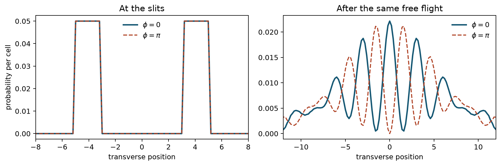
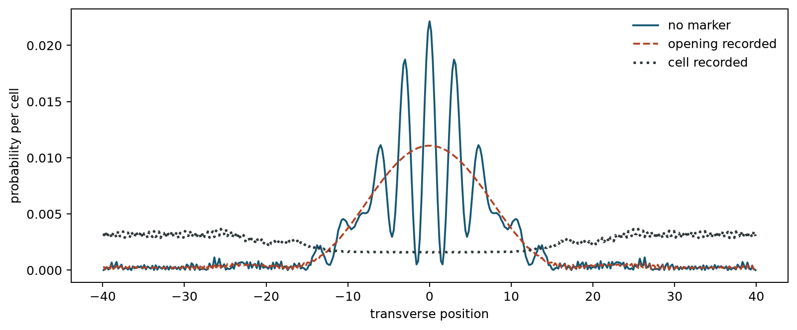
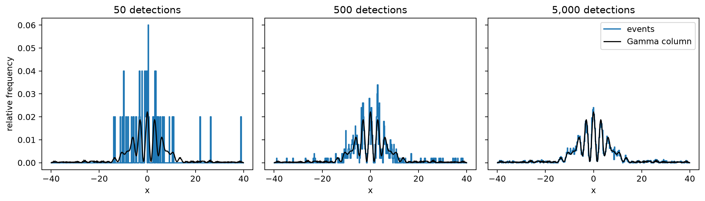
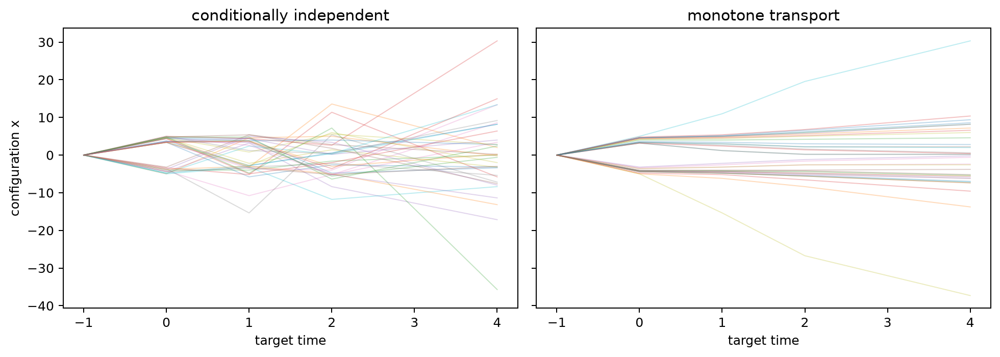
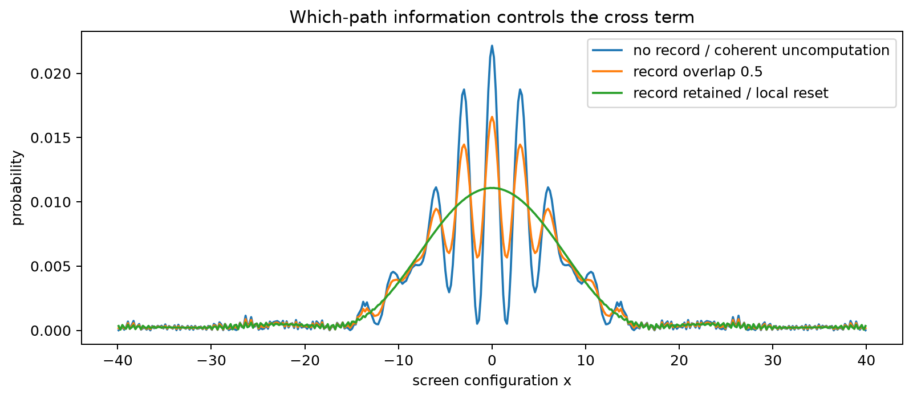
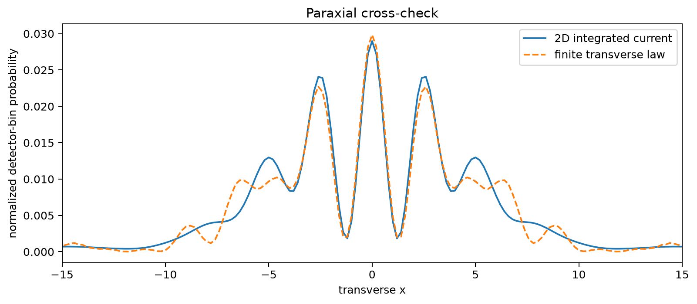
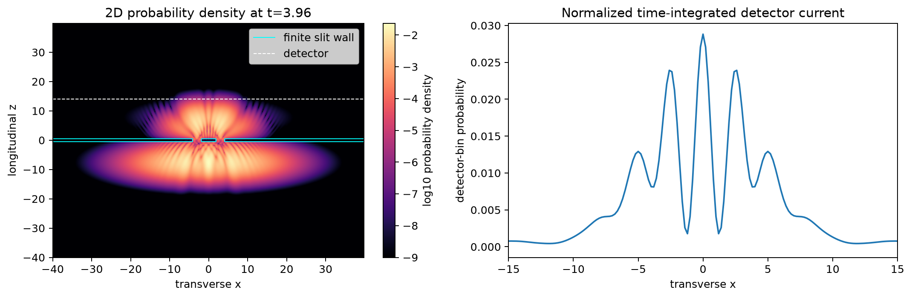

# The Double-Slit Experiment as an Indivisible Stochastic Process

**Original author:** GPT-5.6 Sol (OpenAI Codex)<br>
**Accountable human question asker and project owner:** Mike Famulare

> **Authorship and status.** GPT-5.6 Sol (OpenAI Codex) wrote this exposition
> and implemented the original repository in response to questions and scientific
> direction from Mike Famulare. Mike is the accountable human maintainer, but
> this repository does not present the prose as his authorship. GPT-6 (OpenAI
> Codex) revised the physics and numerical checks at his request. The work has
> not been peer reviewed.

Put a thin phase plate over one opening. Set it to zero on one run and to
$\pi$ on another. A position detector placed at the slits sees identical
histograms. Leave the slit plane unmeasured and place the detector at the
screen instead. The central bin now goes from bright to dark.



*Figure 1. In the 401-cell model the central bin collects 2.21% of the electrons at
phase zero. At phase $\pi$ the upper and lower contributions cancel there
by reflection symmetry. Each panel shows the central part of its plane.*

What would a simulator have to remember to predict that change? A rule
that takes only a slit position as input, applied to the same distribution
of slit positions, must produce the same screen distribution. The relative
phase is physically accessible downstream even though it is absent from the
position histogram at the aperture. Barandes's construction keeps the
preparation in the transition law from the source to each target time.
Once that law is known, an ordinary random draw suffices to generate a hit.

## Contents

1. [The question](#1-the-question)
2. [Barandes's stochastic process](#2-barandess-stochastic-process)
3. [A finite double-slit law](#3-a-finite-double-slit-law)
4. [Interference and stochastic division](#4-interference-and-stochastic-division)
5. [A simulator in positive probability space](#5-a-simulator-in-positive-probability-space)
6. [Two positive path-space realizers](#6-two-positive-path-space-realizers) and [what a hit on the right tells us](#63-a-hit-on-the-right)
7. [Which-path records and erasure](#7-which-path-records-and-erasure)
8. [Numerical and physical cross-checks](#8-numerical-and-physical-cross-checks)
9. [Relation to prior work](#9-relation-to-prior-work)
10. [What the construction does not establish](#10-what-the-construction-does-not-establish)
11. [Reproducing the results](#11-reproducing-the-results)
12. [References](#12-references)

## 1. The question

One screen histogram is easy to explain stochastically. Give every possible
slit position the same outgoing distribution equal to the observed histogram.
This fits every bin, however fine the fringes. The test comes when the
*same* outgoing rule must serve a second preparation.

The phase plate gives the simplest such test. At the slit plane, the two
position distributions agree cell for cell. At the screen their total
variation distance is 0.430. Total variation is the largest difference in
probability that the preparations assign to any set of detector bins. If
the phase settings are equally likely, a single screen hit lets an observer
guess the setting correctly about 71.5% of the time. A single slit-plane
position gives only a 50% chance. The two histograms at different planes
come from separate ensembles. Placing both detectors in series would change
the screen histogram.

Three questions follow. Can a position-only transition reproduce the
family of laws? What does a slit detector physically record? Given a hit
on the right, what can one infer about the slit the electron traversed?
They have different answers even in this one finite model. Sections 4 and
6 work them out.

## 2. Barandes's stochastic process

For a finite system, Barandes packages an indivisible stochastic process as

$$
(\mathcal C,\mathcal T,\mathcal T_0,\Gamma,p,\mathcal A).
$$

The entries have distinct jobs:

- $\mathcal C$ is a finite configuration space.
- $\mathcal T$ is the set of target times.
- $\mathcal T_0\subseteq\mathcal T$ is a usually sparse set of conditioning
  times, also called division events.
- $\Gamma_{ij}(t\leftarrow t_0)=p(i,t\mid j,t_0)$ is a nonnegative,
  column-stochastic transition law for $t\in\mathcal T$ and
  $t_0\in\mathcal T_0$.
- $p_i(t)$ is a standalone probability distribution satisfying
  $p(t)=\Gamma(t\leftarrow t_0)p(t_0)$.
- $\mathcal A$ is the maximal commutative algebra of real random variables
  $A:\mathcal C\times\mathcal T\to\mathbb R$.

At a fixed time, the ordinary event algebra is the power set of $\mathcal C$.
The symbol $\mathcal A$ in the tuple is the algebra of random variables, not
that event algebra.

A divisible stochastic process would supply a stochastic matrix at every
intermediate time $t'$ such that

$$
\Gamma(t\leftarrow t_0)
=\widetilde\Gamma(t\leftarrow t')\Gamma(t'\leftarrow t_0).
$$

An indivisible process does not generally supply such a factorization. It also
does not silently promote every target time to a conditioning time. This sparse
conditioning structure is essential: inserting an extra division event changes
the experimental law rather than revealing a conditional matrix that was
already present.

The tuple fixes first-order conditional probabilities. It does not, by itself,
fix the full tower of higher-order conditionals or a unique measure on whole
trajectories. Barandes therefore treats it as an equivalence class of
stochastic realizers that agree on the observable first-order laws. Section 6
constructs two such realizers explicitly.

Barandes develops the broader causal-local and measurement interpretation in
[*New Prospects for a Causally Local Formulation of Quantum
Theory*](https://arxiv.org/abs/2402.16935) and [*Quantum Systems as Indivisible
Stochastic Processes*](https://arxiv.org/abs/2507.21192v1).

## 3. A finite double-slit law

### 3.1 Configuration space and aperture state

Choose an odd number $N$ of transverse cells on a periodic interval of length
$L_x$. The cell centers are

$$
x_n=\left(n-\frac{N-1}{2}\right)\Delta x,
\qquad
n=0,\ldots,N-1,
\qquad
\Delta x=\frac{L_x}{N}.
$$

The displayed screen lies far from the periodic boundary. Let $S_U$ and $S_L$
be disjoint sets of upper- and lower-slit cells. Their normalized box modes are

$$
(a_U)_n=\frac{\mathbf 1[x_n\in S_U]}{\sqrt{|S_U|}},
\qquad
(a_L)_n=\frac{\mathbf 1[x_n\in S_L]}{\sqrt{|S_L|}}.
$$

Disjoint support gives $\langle a_U,a_L\rangle=0$. A slit preparation with
upper-slit weight $q$ and relative phase $\phi$ is

$$
\psi_{q,\phi}
=\sqrt q\thinspace a_U+e^{i\phi}\sqrt{1-q}\thinspace a_L,
\qquad 0\le q\le 1.
$$

The cases $q=1$ and $q=0$ condition on transmission through one open slit; $q=1/2$ is a balanced double
slit. Unlike a point-slit delta function sampled on a grid, this finite vector
has unit Euclidean norm.

### 3.2 A full unitary preparation

Let $e_{j_s}$ denote one definite source configuration. To model every initial configuration, choose a full unitary matrix
$P$ whose source column equals the slit state. Set

$$
v=e_{j_s}-\psi_{q,\phi},
\qquad
P=I-\frac{vv^\dagger}{v^\dagger e_{j_s}}
$$

when $v\ne0$, and use $P=I$ when source and target already coincide. Then
$Pe_{j_s}=\psi_{q,\phi}$. To check unitarity, write
$d=v^\dagger e_{j_s}$. Normalization of the source and target gives
$v^\dagger v=d+\overline d$; substituting this identity into $P^\dagger P$
gives $P^\dagger P=I$.

For nearly coincident vectors the code uses two well-conditioned unitary maps
through an intermediate vector with opposite sign. This completion is not unique. Every allowed completion agrees
on the prepared source column, but different completions define different
columns of $\Gamma$ for counterfactual initial configurations. The completion
is therefore an explicit model choice, not a gauge equivalence.

### 3.3 Free propagation and the positive law

Let $F$ be the unitary discrete Fourier transform and

$$
k_r=2\pi\thinspace \mathrm{fftfreq}(N,\Delta x).
$$

For the finite periodic kinetic Hamiltonian $H=p^2/(2m)$, the exact spectral
propagator is

$$
G(t)=F^\dagger
\mathrm{diag}\negthinspace \left[
\exp\negthinspace \left(-\frac{i\hbar k_r^2t}{2m}\right)
\right]F.
$$

Every diagonal phase has unit modulus, so $G(t)$ is unitary.

Use a source-stage label $t_s=-1$ and a slit time $0$. The label $-1$ is not a
unit of physical flight; it separates preparation from propagation. For any
target flight time $t\ge0$, define

$$
U(t\leftarrow t_s)=G(t)P,
\qquad
\boxed{\Gamma_{ij}(t\leftarrow t_s)
=|U_{ij}(t\leftarrow t_s)|^2}.
$$

Because $U$ is unitary,

$$
\Gamma_{ij}\ge0,
\qquad
\sum_i\Gamma_{ij}=1
$$

for every column $j$. Thus $\Gamma$ is a complete finite unistochastic matrix,
not a sampled continuum kernel checked only on the prepared state.

The process tuple for the experiment is

$$
\begin{aligned}
\mathcal C &= \lbrace x_0,\ldots,x_{N-1}\rbrace ,\\
\mathcal T &= \lbrace t_s\rbrace \cup[0,\infty),\\
\mathcal T_0 &= \lbrace t_s\rbrace ,\\
p_j(t_s) &= \delta_{j j_s},\\
p_i(t) &= \Gamma_{i j_s}(t\leftarrow t_s),\\
\mathbb E[A(t)] &= \sum_i a_i(t)p_i(t).
\end{aligned}
$$

The code materializes any requested finite subset of $\mathcal T$. Since
$\mathcal T_0$ contains only $t_s$, it does not infer a new law conditioned at
the slit or detector.

## 4. Interference and stochastic division

Suppose a unitary evolution factors at an intermediate time:

$$
U(t\leftarrow t_s)=A(t\leftarrow t')B(t'\leftarrow t_s).
$$

Taking entrywise squared moduli gives

$$
\begin{aligned}
\Gamma_{ij}(t\leftarrow t_s)
&=\left|\sum_k A_{ik}B_{kj}\right|^2\\
&=\sum_k|A_{ik}|^2|B_{kj}|^2
+\sum_{k\ne\ell}
A_{ik}B_{kj}\overline{A_{i\ell}B_{\ell j}}.
\end{aligned}
$$

The first term is the divided stochastic prediction,

$$
[\Gamma_A\Gamma_B]_{ij}
=\sum_k|A_{ik}|^2|B_{kj}|^2.
$$

The second term is the interference residual. The unitary matrices compose;
their entrywise squared moduli generally do not. This is Barandes's general
interference identity
([*The Stochastic-Quantum Correspondence*](https://arxiv.org/abs/2302.10778),
Section 3.5).

For a division inserted at the slit plane, the repository compares

$$
\Gamma_{\mathrm{direct}}(t\leftarrow t_s)=|G(t)P|^{\circ2}
$$

with

$$
\Gamma_{\mathrm{divided}}(t\leftarrow t_s)
=|G(t)|^{\circ2}|P|^{\circ2}.
$$

The second matrix describes an ideal unread measurement of **which cell**
the electron occupied at the slit plane. It removes coherence between every
pair of distinct cells, including pairs inside the same opening. An ideal
**which-slit** marker preserves coherence within each opening and gives the
weighted sum of two single-slit diffraction patterns (Section 7).

A nonzero residual rules out this particular restart kernel. To establish
indivisibility at that time one must rule out *every* column-stochastic
kernel that could carry the full earlier matrix to the later one.

### 4.1 The two-state example

The smallest example uses the Hadamard matrix

$$
H_2=\frac{1}{\sqrt2}
\begin{pmatrix}
1&1\\
1&-1
\end{pmatrix}.
$$

Starting in $e_1$, prepare with $H_2$ and propagate with $H_2$. Direct unitary
evolution gives $H_2H_2=I$ and hence $p=(1,0)$. Artificial stochastic division
gives

$$
|H_2|^{\circ2}|H_2|^{\circ2}e_1=(1/2,1/2).
$$

The other input $e_2$ gives the same halfway distribution and ends at the
opposite output. A single stochastic matrix acting on the same halfway input
must return the same distribution both times. This rules out every restart
kernel for the two-input experiment. For $e_1$ alone, a kernel with both
columns equal to $(1,0)$ fits the final histogram exactly.

### 4.2 The spatial pattern

Define propagated upper and lower slit modes

$$
u(t)=G(t)a_U,
\qquad
\ell(t)=G(t)a_L.
$$

The selected source column gives the screen probability

$$
\boxed{
p_i(t)=q|u_i|^2+(1-q)|\ell_i|^2
+2\sqrt{q(1-q)}\mathrm{Re}
\negthinspace \left[e^{i\phi}\overline{u_i}\ell_i\right].
}
$$

Closing one slit sets one branch weight to zero. Changing $\phi$ moves the
fringes without changing normalization.

An unread marker with two possible records leaves
$q|u_i|^2+(1-q)|\ell_i|^2$ at the screen. Amplitudes from different cells
of the *same* opening still add coherently. A marker with a separate record
for each cell also removes those cross terms. With one slit closed, an opening label carries no information and leaves
the single-slit diffraction pattern intact. A cell label can still change it.



*Figure 2. Same incoming state, same flight time. Recording the opening moves 0.215
of the probability mass in total variation from the coherent pattern.
Recording the cell moves 0.700 relative to the coherent pattern. The broad
cell-resolved curve depends on the grid spacing and periodic box. It models
localization to a single lattice cell.*

### 4.3 Does any stochastic restart work?

A residual can be large even when a stochastic factor exists. For example,
rotate a two-component amplitude by $30^\circ$ twice. After the first
rotation the probability column for input 1 is $(3/4,1/4)$, after the second
it is $(1/4,3/4)$. The columns for input 2 are reversed throughout. Composing
the two squared rotation matrices would give $(5/8,3/8)$ for input 1. Yet
swapping the two positions takes **both** earlier columns exactly to their
later values. The swap fits the matrices at this pair of times. A separate
measurement protocol would be needed to identify it as an actual transition.

For the spatial model we can rule out every such factor with one inequality.
If $K$ is column-stochastic, moving probability according to $K$ cannot
increase the distance between two distributions $a,b$. Indeed,

$$
d_{\rm TV}(Ka,Kb)
=\frac12\sum_i\left|\sum_j K_{ij}(a_j-b_j)\right|
\leq\frac12\sum_{ij}K_{ij}|a_j-b_j|
=d_{\rm TV}(a,b).
$$

Hold the reference preparation matrix $P$ fixed. Feed it either the definite
source $e_{j_s}$ or a classical uniform draw from the 20 source indices
aligned with aperture cells. In the second case the random choice is made
*before* applying $P$. Propagate both distributions using the columns of
the same $\Gamma$.

| Pair compared | Distance at the slits | Distance at the screen |
| --- | ---: | ---: |
| Two source distributions, one fixed $P$ | 0.050 | 0.735 |
| One source, two phase settings | 0 | 0.430 |

The first row violates the inequality. No column-stochastic matrix carries
the full reference law from the slit plane to this screen time. This
conclusion uses the specified unitary completion, since the second source
samples columns beyond the one used in the beam. The second row asks whether one free-flight kernel can serve both phase settings.
It depends only on the two prepared states and survives every choice of
their unused columns. A simulator given the phase as an extra input can
tell the settings apart. The obstruction concerns a restart on position alone.

## 5. A simulator in positive probability space

The simulator has complex Hamiltonian dynamics under the hood only while it
constructs $\Gamma$. The returned `FiniteIndivisibleProcess` stores immutable
floating-point probability vectors and column-stochastic matrices. Its module
has no Hamiltonian or complex-amplitude dependency. It rejects negative laws,
normalization failures, missing $(t,t_0)$ pairs, nontrivial identity-time laws,
and compositions that violate the declared conditioning structure.

After construction, a screen event is an ordinary categorical sample:

```python
import numpy as np

from non_markovian_double_slit.finite import FiniteDoubleSlitModel

model = FiniteDoubleSlitModel.create()
process = model.process([0.0, 1.0, 2.0])
screen_probability = process.marginal(2.0)

rng = np.random.default_rng(7)
events = rng.choice(process.size, size=5_000, p=screen_probability)
```

No amplitude evolves during event generation. The screen pattern is the
large-sample frequency profile of independent draws from one positive column of
$\Gamma$.



*Figure 3. Event frequencies approach the positive screen law as the number of
detections grows.*

## 6. Two positive path-space realizers

The first-order process tuple does not determine what an individual path does
between the source and the screen. To make that underdetermination executable,
the repository supplies two positive path measures with the same one-time
marginals.

Fix target times $t_1,\ldots,t_R$, let $J=X_{t_s}$, and write

$$
\mu_r^{(j)}(i)=\Gamma_{ij}(t_r\leftarrow t_s).
$$

### 6.1 Conditional-independence realizer

On the finite path space $\Omega=\mathcal C^{R+1}$, define

$$
\mathbb P_{\mathrm{ind}}
(J=j,X_{t_1}=i_1,\ldots,X_{t_R}=i_R)
=p_j(t_s)\prod_{r=1}^R\mu_r^{(j)}(i_r).
$$

This joint law is normalized and nonnegative, and each $X_{t_r}$ has the
required marginal. Adding or removing target times preserves consistency.

### 6.2 Monotone-transport realizer

For each initial $j$, draw one latent rank
$Z\sim\mathrm{Uniform}(0,1)$ and set

$$
X_{t_r}=Q_{\mu_r^{(j)}}(Z),
$$

where $Q_\mu$ is the inverse CDF on the ordered screen cells. Reusing one rank
couples neighboring times monotonically and minimizes one-dimensional
quadratic displacement for each pair of marginals.

This realizer uses the displayed linear coordinate, not cyclic distance. That
extra convention is appropriate only while probability near the periodic
boundary is negligible.

Conditional on an initial configuration $j$, both realizers use the
corresponding column of every requested $\Gamma$; the actual experiment assigns
positive prior mass only to the prepared source $j_s$. The realizers do not
agree about individual histories. In the reference run, the independent
realizer's expected **sum** of squared displacements is $263.26$, while the transport
realizer's is $35.77$. The difference has no effect on any one-time screen law.
It shows why the trajectory measure is an additional modeling choice rather
than a quantum prediction.



*Figure 4. Two ordinary positive path ensembles with identical one-time
marginals and different temporal roughness.*

### 6.3 A hit on the right

Take a hit on the right half of the unmarked screen, $R=(x>0)$. What is
the probability that the electron was in the upper slit, $U$, at the aperture?
The model supplies $P(U)=0.5$ and $P(R)=0.4889$. For any joint law with
those marginals, the overlap of the two events obeys

$$
\max(0,P(U)+P(R)-1)\leq P(U\cap R)\leq\min(P(U),P(R)).
$$

The endpoints are attainable. There is enough upper-slit mass to supply
every right-hand hit, and enough lower-slit mass to do the same. Within
each event one can distribute the mass across cells in the required
proportions. The allowed interval for $P(U\mid R)$ is therefore **the entire
interval from zero to one**, even with exact histograms at both planes.
The independent realizer gives 0.5. The monotone realizer sends the largest
ranks to the largest positions at both planes and gives 1. Other one-time
marginals can be appended by draws conditioned on the source, so observing
more unmarked ensembles at intermediate times does not close this interval.

Now install an ideal upper/lower marker. The record and screen hit can be
read in the same run. The Born probabilities give
$P(U,R)=q\sum_{i\in R}|u_i|^2$ and $P(R)$ is the right-hand mass of the
recorded mixture. Their ratio is **0.790**. This number answers a laboratory
question with two recorded outcomes. Using it for the unmarked run would
require an additional assumption about how histories respond to the marker.

<a id="13-assessment-equivalence-class-versus-classical-trajectory"></a>

### 6.4 What it means to have a trajectory

Mike Famulare raised a question about the phrase *classically stochastic*.
For a classical path model, conditioning on a later hit is an ordinary
question about the joint law. The interval above gives the exact extent
to which that question stays open here. Indeed, for the definite source
the independent realizer is itself a time-inhomogeneous Markov chain because each step draws
afresh from the prescribed marginal. The no-restart result in
Section 4 concerns a **shared** kernel for multiple preparations.

Barandes explicitly allows a run to have one actual history while treating
the choice of a full tower of conditional probabilities as contingent and
possibly physically meaningless. An actual history in each run is compatible
with a theory that leaves its distribution unspecified. The additional
commitment comes when a proposed dynamics assigns odds to one unmeasured
history versus another. In this example the disagreement runs from zero to
certainty for the same hit. All the screen predictions survive it.
[Barandes, *Quantum Systems as Indivisible Stochastic Processes*, v2, Section 2](https://arxiv.org/html/2507.21192v2#S2).

## 7. Which-path records and erasure

Let the two propagated slit branches become correlated with record states
$|r_U\rangle$ and $|r_L\rangle$:

$$
|\Psi\rangle
=\sqrt q\thinspace |u\rangle|r_U\rangle
+e^{i\phi}\sqrt{1-q}\thinspace |\ell\rangle|r_L\rangle.
$$

Write their overlap as $\mu=\langle r_U|r_L\rangle$. Ignoring the record gives

$$
p_i=q|u_i|^2+(1-q)|\ell_i|^2
+2\sqrt{q(1-q)}\mathrm{Re}
\negthinspace \left[e^{i\phi}\overline{u_i}\ell_i\mu\right].
$$

- Indistinguishable marker states give $|\mu|=1$. Their relative phase adds
  to $\phi$.
- If orthogonal records are retained, $\mu=0$ and the electron screen is the
  incoherent mixture.
- For pure markers the optimal path-guessing success probability is
  $(1+D)/2$, where $D=\sqrt{1-4q(1-q)|\mu|^2}$. Identical records leave
  the prior odds available. At equal priors this reduces to
  $D=\sqrt{1-|\mu|^2}$. At a given detector bin, the contrast under a scan
  of $\phi$ also depends on the relative intensities arriving from each slit.

A local unitary on the record preserves $\mu$, so it cannot restore the screen
interference. A physical local reset channel cannot restore it either. In a
unitary dilation, reset has the form

$$
\begin{aligned}
|r_U\rangle|b_0\rangle&\longmapsto|r_0\rangle|b_U\rangle,\\
|r_L\rangle|b_0\rangle&\longmapsto|r_0\rangle|b_L\rangle.
\end{aligned}
$$

The which-path record has moved into the bath. It has not been erased from the
closed composite system.

Fringes can return in two physically distinct ways:

1. **Global coherent uncomputation** reverses the original path-record
   interaction before propagation to the screen.
2. **Conditional quantum erasure** measures orthogonal records in the
   $|\pm\rangle=(|r_U\rangle\pm|r_L\rangle)/\sqrt2$ basis. The joint screen
   probabilities are given below.

$$
p_\pm(i)=\frac12\left|
\sqrt q\thinspace u_i\pm e^{i\phi}\sqrt{1-q}\thinspace \ell_i
\right|^2.
$$

Each record outcome has probability $1/2$ because the propagated slit modes
are orthogonal. The plotted conditional curves are $2p_+$ and $2p_-$. Their
equal-weight average gives the recorded mixture,

$$
p_+(i)+p_-(i)=q|u_i|^2+(1-q)|\ell_i|^2.
$$



*Figure 5. A retained record and a local reset give the same electron marginal;
global uncomputation restores the coherent law.*


*Figure 6. The two conditional curves average to the unconditional screen
pattern. Each subset contains half of the detections in expectation.*

## 8. Numerical and physical cross-checks

### 8.1 Finite-model invariants

The committed figures use the reference profile. The principal numerical
checks are:

| Check | Result |
| --- | ---: |
| preparation unitarity error | $1.0\times10^{-15}$ |
| evolution unitarity error | $1.6\times10^{-15}$ |
| stochastic normalization/negativity error | $1.6\times10^{-15}$ |
| coherent versus cell-resolved total-variation distance | $0.700$ |
| local-reset versus retained-record error | $0$ |
| eraser aggregate versus recorded-mixture error | $6.9\times10^{-18}$ |

The reset routine uses the retained-record formula, so its zero difference
is an identity of the implementation. The eraser aggregate is computed from
the two joint Born probabilities.

### 8.2 Continuum electron benchmark

For comparison with physical electron scales, the one-dimensional free kernel
is

$$
K(x,t;x',0)=\sqrt{\frac{m}{2\pi i\hbar t}}
\exp\negthinspace \left[\frac{im(x-x')^2}{2\hbar t}\right].
$$

The repository reproduces David LeBlond's midpoint quadrature using
$\lambda=1.23\times10^{-10}\thinspace \mathrm m$, wall-to-screen distance
$L=1\thinspace \mathrm m$, slit width $a=1.5\times10^{-9}\thinspace \mathrm m$, and center
separation $d=6.15\times10^{-9}\thinspace \mathrm m$. The paraxial fringe scale is

$$
\Delta x\simeq\frac{\lambda L}{d}=0.020\thinspace \mathrm m.
$$

The corrected calculation resolves $0.01950\thinspace \mathrm m$. This continuum
quadrature is a physical-units benchmark, not the finite stochastic tuple:
sampled kernel values on unequal grids do not by themselves form a verified
finite unitary matrix. Bauer's point-slit solution supplies the corresponding
analytic phase and fringe displacement
([Bauer, 2013](https://arxiv.org/abs/1304.1767), Eqs. 5-9).

### 8.3 Two-dimensional finite-barrier benchmark

The supporting two-dimensional model evolves a wave packet through a finite
barrier with two openings:

$$
i\hbar\partial_t\psi
=\left[-\frac{\hbar^2}{2m}(\partial_x^2+\partial_z^2)+V(x,z)\right]\psi.
$$

A Strang split step performs the numerical evolution. The detector observable
is not the density at an arbitrary final time; it is the signed,
time-integrated longitudinal current

$$
J_z(x,z_d,t)=\frac{\hbar}{m}\mathrm{Im}
\negthinspace \left[\overline\psi\thinspace \partial_z\psi\right],
\qquad
F(x)=\int_0^T J_z(x,z_d,t)\thinspace dt.
$$

The detector differentiates in the same Fourier basis as the kinetic
Hamiltonian. It integrates positive and negative currents separately over
position and time. All time-integrated bins in the reference run are positive,
although some instantaneous currents reverse sign. The screen histogram
conditions on flux crossing the plane during $0\leq t\leq 7.2$.

| 2D check | Result |
| --- | ---: |
| norm error | $2.5\times10^{-13}$ |
| maximum boundary probability | $4.7\times10^{-6}$ |
| net flux through the detector | $0.25698$ |
| backward flux / forward flux | $1.46\times10^{-7}$ |
| finite-law versus 2D correlation | $0.984$ |
| finite-law versus 2D total variation | $0.103$ |

The ideal paraxial central spacing is $2.666$ dimensionless units. The resolved
central spacings are $2.50$ in the 2D run and $2.30$ in the finite transverse
law. Finite slit width, barrier geometry, and grid resolution may each
contribute. Halving the time step on the same spatial grid changes the
normalized 2D histogram by 0.0066 in total variation. The comparison tests
the shape conditional on transmission, with no independent calibration of
source brightness or detection efficiency.





*Figure 7. A finite wall, propagated density, and the normalized
time-integrated-current detector law.*

## 9. Relation to prior work

This repository is not the first double-slit application of Barandes's
framework.

- Barandes's [*Double-Slit Interference for a Unistochastic Process*](https://shared.jacobbarandes.com/documents/double-slit-interference-unistochastic-lecture-notes)
  gives the direct two-configuration toy model and introduces a two-state
  which-path indicator.
- David LeBlond's [*The electron double-slit experiment from an ISP
  perspective*](https://arxiv.org/abs/2511.02863) extends the calculation to
  2,000 sampled slit and screen positions with a free-particle kernel and R
  implementation.
- M. Bauer's [*On time and space double-slit
  experiments*](https://arxiv.org/abs/1304.1767) gives a schematic analytic
  point-slit solution, including relative phase and partial slit weights.

This repository adds a full finite unitary and all-column $\Gamma$, an explicit
implementation of the entire process tuple, two positive path-space realizers,
a total-variation test for a common stochastic restart, a physical separation of local reset
from global uncomputation and conditional erasure, and a 2D signed-current
cross-check.

### 9.1 The meaning of "forgetting"

Barandes's lecture notes explicitly introduce the many-to-one matrix

$$
\Theta_E=
\begin{pmatrix}
1&1\\
0&0
\end{pmatrix}.
$$

Its columns are normalized, so it can serve as a many-to-one stochastic
potential in the broader formalism. It is not unitary:

$$
\Theta_E^\dagger\Theta_E
=\begin{pmatrix}
1&1\\
1&1
\end{pmatrix}\ne I.
$$

Read as a single Kraus operator, it is also not a trace-preserving local reset
channel. The algebraic fringe-restoration result is valid if "forgetting"
means global controlled uncomputation, or if one conditions on a complementary
record measurement. It is not the result of physically resetting only the
local record while discarding the bath. This is a distinction between physical
operations, not an objection to the unistochastic framework.

### 9.2 LeBlond's indexing

The Python reproduction finds that LeBlond's published upper-slit loop uses a
global index where a local slit index is required. It shifts the upper slit by
one full slit width. The published plot is internally consistent with the
geometry evaluated by the code, but not with its stated slit separation.

| Quantity | Intended/corrected | Published code |
| --- | ---: | ---: |
| lower center | $-3.075\thinspace \mathrm{nm}$ | same |
| upper center | $+3.075\thinspace \mathrm{nm}$ | $+4.575\thinspace \mathrm{nm}$ |
| effective separation | $6.15\thinspace \mathrm{nm}$ | $7.65\thinspace \mathrm{nm}$ |
| predicted spacing for effective separation | $0.0200\thinspace \mathrm m$ | $0.01608\thinspace \mathrm m$ |
| measured numerical spacing | $0.01950\thinspace \mathrm m$ | $0.015825\thinspace \mathrm m$ |

The plotting coordinates are also shifted by one screen bin
($1.5\times10^{-4}\thinspace \mathrm m$), although that offset does not change the
computed amplitudes.


*Figure 8. LeBlond's published indexing and the corrected local upper-slit
indexing.*

## 10. What the construction does not establish

The calculations and tests support the stated finite model. They do not:

1. **Derive the Hamiltonian autonomously.** The kinetic Hamiltonian constructs
   the law. Deriving it from lower-level stochastic assumptions would be a
   separate research objective, not a condition for using Barandes's
   stochastic-quantum correspondence.
2. **Select one true trajectory realizer.** The two realizers demonstrate that
   the first-order laws leave whole histories underdetermined.
3. **Prove a continuum limit.** The exact model is a finite periodic lattice.
   The continuum and 2D calculations are cross-checks.
4. **Remove the completion choice.** Unused source columns depend on the chosen
   unitary completion of the prepared state.
5. **Model a complete laboratory apparatus.** The source, slit preparation,
   environment, and detector are controlled mathematical models rather than a
   detailed electron-gun experiment.
6. **Provide peer review or experimental confirmation.** Numerical agreement
   among the repository's constructions is an internal validation.

## 11. Reproducing the results

Python environments and commands are managed with
[uv](https://docs.astral.sh/uv/).

### Quick verification

```bash
uv sync
uv run pytest
uv run ruff check src tests scripts
uv run python scripts/reproduce.py --profile quick
uv run python scripts/reproduce_leblond.py
```

### Regenerate the committed reference artifacts

```bash
uv run python scripts/reproduce.py \
  --profile reference \
  --output docs/figures \
  --metrics docs/data/reference_metrics.json

uv run python scripts/reproduce_leblond.py \
  --output docs/figures/leblond_reproduction.png \
  --metrics docs/data/leblond_metrics.json
```

The reference profile is more expensive than the quick profile. Scratch runs
default to the ignored `outputs/` directory.

### Repository map

| Path | Role |
| --- | --- |
| `src/non_markovian_double_slit/process.py` | positive-law tuple; no amplitude or Hamiltonian dependency |
| `src/non_markovian_double_slit/finite.py` | finite Hilbert-space construction of $\Gamma$ |
| `src/non_markovian_double_slit/realizers.py` | two positive path measures |
| `src/non_markovian_double_slit/which_path.py` | record overlap, reset, uncomputation, and erasure |
| `src/non_markovian_double_slit/lattice2d.py` | supporting split-step finite-barrier model |
| `scripts/` | reproducible figures and diagnostics |
| `tests/` | semantic and numerical invariants |
| `docs/prior-work-audit.md` | detailed source-specific audit |
| `docs/source-notes/` | paper locators and provenance notes |
| `literature/` | licensed source PDFs and checksums |

This README is the canonical reader-facing exposition. The documents under
`docs/` retain more compact derivations and source-specific audit trails.

## 12. References

1. Jacob A. Barandes, [*The Stochastic-Quantum
   Correspondence*](https://arxiv.org/abs/2302.10778), arXiv:2302.10778v3.
2. Jacob A. Barandes, [*The Stochastic-Quantum
   Theorem*](https://arxiv.org/abs/2309.03085), arXiv:2309.03085v2.
3. Jacob A. Barandes, [*New Prospects for a Causally Local Formulation of
   Quantum Theory*](https://arxiv.org/abs/2402.16935), arXiv:2402.16935v1.
4. Jacob A. Barandes, [*Quantum Systems as Indivisible Stochastic
   Processes*](https://arxiv.org/abs/2507.21192v1), arXiv:2507.21192v1.
5. Jacob A. Barandes, [*Double-Slit Interference for a Unistochastic
   Process*](https://shared.jacobbarandes.com/documents/double-slit-interference-unistochastic-lecture-notes),
   Lecture Notes #22.
6. David LeBlond, [*The electron double-slit experiment from an ISP
   perspective*](https://arxiv.org/abs/2511.02863), arXiv:2511.02863v1.
7. M. Bauer, [*On time and space double-slit
   experiments*](https://arxiv.org/abs/1304.1767), arXiv:1304.1767v3.

Archived PDFs, versions, licenses, and SHA-256 checksums are listed in
[`literature/README.md`](literature/README.md).

## Citation, license, and responsibility

`CITATION.cff` names Mike Famulare for citation of the software repository. The
technical exposition in this README is credited to the Codex models
identified at the top of the document. OpenAI has not independently reviewed
or endorsed its scientific claims.

Code is MIT licensed. Original prose and generated figures are CC BY 4.0.
Third-party papers under `literature/` retain their own licenses; see
[`THIRD_PARTY.md`](THIRD_PARTY.md).
