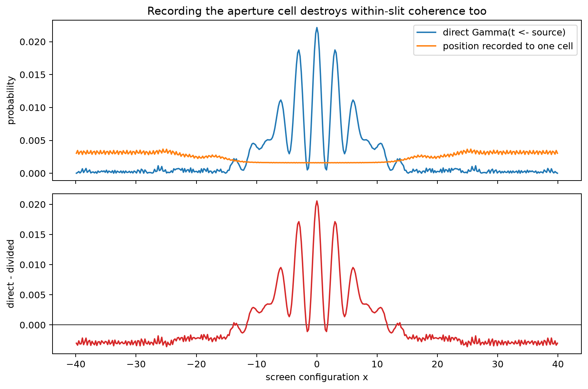
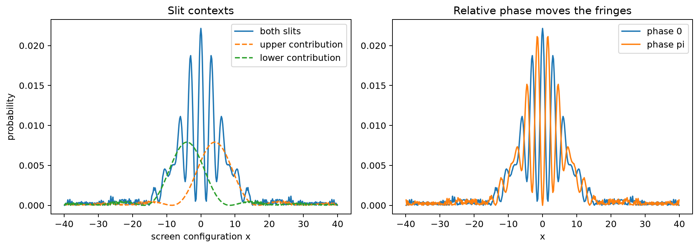
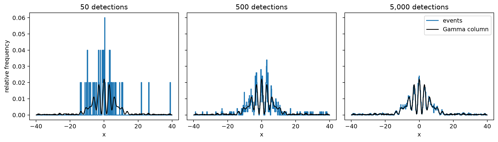
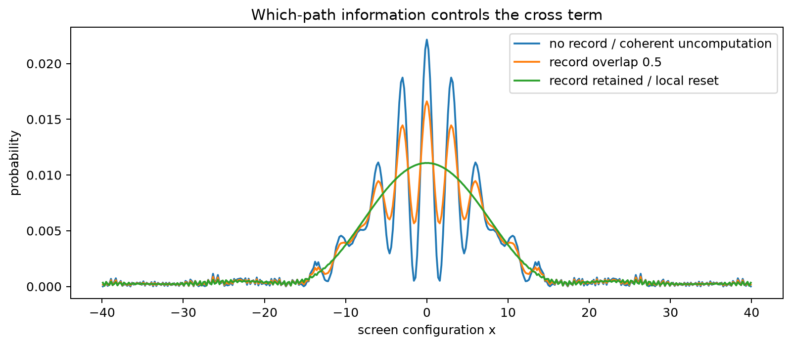
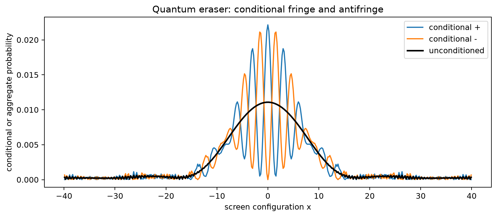
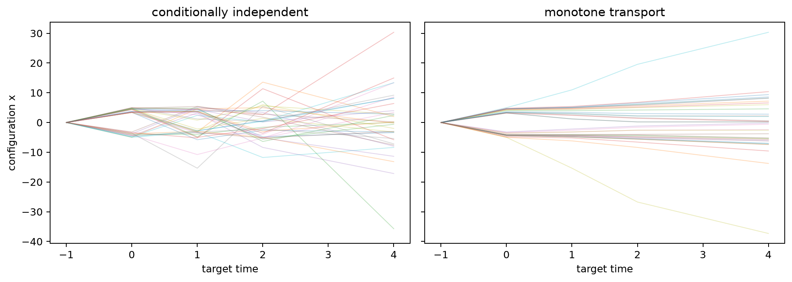
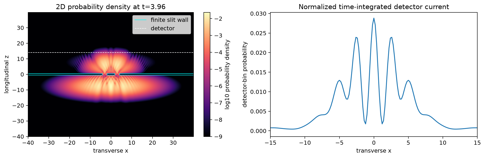
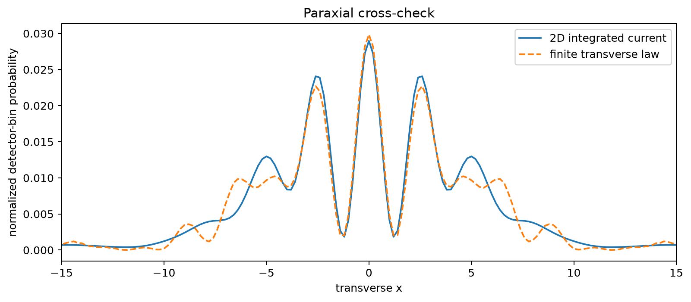

# A double slit as an indivisible stochastic process

## What is being constructed

This project constructs a family of ordinary, nonnegative transition
probabilities on a finite configuration space. A Hilbert-space calculation
constructs that family; it is not subsequently treated as a hidden trajectory.
The code keeps the construction and stochastic layers separate:

```text
kinetic Hamiltonian -> unitary U -> Gamma = |U|^2 -> positive laws -> events/paths
```

Using a Hamiltonian is part of Jacob Barandes's framework. The
stochastic-quantum theorem says that every finite indivisible
stochastic process can be represented as a subsystem of a unistochastic
process, and the converse dictionary reads a unitary quantum model as a family
of stochastic laws. The Hilbert-space representation supplies the dynamics; it
is not an additional ontology
([Barandes 2023a, Sections 3.5 and 4](https://arxiv.org/abs/2309.03085);
[Barandes 2023b, Sections 3.4-3.5](https://arxiv.org/abs/2302.10778)).

The exact finite construction is dimensionless. The continuum
electron and two-dimensional calculations are supporting benchmarks, not the
definition of the stochastic process.

## 1. The process tuple

Barandes defines a finite indivisible stochastic process by

$$
    (\mathcal C,\mathcal T,\mathcal T_0,\Gamma,p,\mathcal A).
$$

In the notation of [*The Stochastic-Quantum Theorem*, Eqs. 24-42,
pp. 8-12](https://arxiv.org/abs/2309.03085):

- $\mathcal C$ is the configuration space.
- $\mathcal T$ is the set of target times.
- $\mathcal T_0\subset\mathcal T$ is the usually sparse set of
  conditioning times, or division events.
- $\Gamma_{ij}(t\leftarrow t_0)=p(i,t\mid j,t_0)$ is a nonnegative,
  column-stochastic transition law for $t\in\mathcal T$ and
  $t_0\in\mathcal T_0$.
- $p_i(t)$ is the standalone probability distribution, with
  $p(t)=\Gamma(t\leftarrow t_0)p(t_0)$.
- $\mathcal A$ is the maximal commutative algebra of real random variables
  $A:\mathcal C\times\mathcal T\to\mathbb R$.

The $\mathcal A$ in this tuple is an algebra of random variables, not the
event algebra. At any fixed time, the ordinary event algebra is separately the
power set of the finite $\mathcal C$.

### This model's tuple

Choose an odd integer $N$, interval length $L_x$, and cell spacing
$\Delta x=L_x/N$. The configurations are

$$
  \mathcal C=\lbrace x_n=(n-(N-1)/2)\Delta x:n=0,\ldots,N-1\rbrace .
$$

The kinetic calculation uses periodic boundaries, so algebraically this is a
cyclic lattice. The displayed screen is kept far from its boundary.

Use a source-stage label $t_s=-1$, slit time $0$, and arbitrary target
flight times $t\geq0$:

$$
  \mathcal T=\lbrace t_s\rbrace \cup[0,\infty),\qquad
  \mathcal T_0=\lbrace t_s\rbrace .
$$

The label $-1$ is not one unit of free flight; it separates preparation from
propagation. The code materializes any requested finite subset of
$\mathcal T$. It defines

$$
  \Gamma(t_s\leftarrow t_s)=I,
  \qquad
  \Gamma(t\leftarrow t_s)=|U(t\leftarrow t_s)|^{\circ2},
$$

where $|\cdot|^{\circ2}$ means entrywise modulus-square. The initial
distribution is the definite configuration

$$
  p_j(t_s)=\delta_{j j_s},
$$

and all standalone probabilities are

$$
  p_i(t)=\sum_j\Gamma_{ij}(t\leftarrow t_s)p_j(t_s)
        =\Gamma_{i j_s}(t\leftarrow t_s).
$$

The algebra $\mathcal A$ contains every assignment of a real magnitude
$a_i(t)$ to each configuration and time, with

$$
  \mathbb E[A(t)]=\sum_i a_i(t)p_i(t).
$$

Because $\mathcal T_0$ is a singleton, composition between division events is
vacuous. No law conditioned at the slit or detector is silently added to the
tuple.

## 2. Constructing the unistochastic law

### Apertures and phase

Let $S_U,S_L\subset\mathcal C$ be disjoint upper and lower aperture cells.
Define normalized box modes

$$
  (a_U)_n=\frac{\mathbf 1[x_n\in S_U]}{\sqrt{|S_U|}},\qquad
  (a_L)_n=\frac{\mathbf 1[x_n\in S_L]}{\sqrt{|S_L|}}.
$$

Their supports are disjoint, so $\langle a_U,a_L\rangle=0$. The prepared
slit state is

$$
  \psi_{q,\phi}=\sqrt q\thinspace a_U+e^{i\phi}\sqrt{1-q}\thinspace a_L,
  \qquad 0\leq q\leq1.
$$

Thus $q=1,0$ are the one-slit contexts, and $q=1/2$ is a balanced
double slit. Unlike unnormalized point-slit expressions, this vector has unit
Euclidean norm on the finite configuration space.

### Unitary preparation

Let $e_{j_s}$ be the source configuration vector, set
$v=e_{j_s}-\psi_{q,\phi}$, and, when $v\neq0$, define

$$
  P=I-\frac{vv^\dagger}{v^\dagger e_{j_s}}.
$$

Then $Pe_{j_s}=\psi_{q,\phi}$. It is unitary because, with
$d=v^\dagger e_{j_s}$, one has $v^\dagger v=d+\bar d$, which makes
$P^\dagger P=I$. If source and target already coincide, take $P=I$.
Near coincidence, the code uses two stable unitary maps via the negative of the
source vector. The completion is not unique. That nonuniqueness affects
unused columns of the chosen model, not the prepared source column. It is a
declared model choice rather than a gauge equivalence: another unitary
completion would define a different full $\Gamma$ for counterfactual initial
configurations while agreeing on the definite-source experiment.

### Free propagation

Let $F$ be the unitary discrete Fourier transform and

$$
  k_r=2\pi\thinspace \mathrm{fftfreq}(N,\Delta x).
$$

For the finite periodic kinetic Hamiltonian $H=p^2/(2m)$, the exact
finite-dimensional propagator is

$$
  G(t)=F^\dagger
       \mathrm{diag}\negthinspace \left[
         \exp\negthinspace \left(-\frac{i\hbar k_r^2t}{2m}\right)
       \right]F.
$$

The source-to-target unitary and stochastic law are

$$
  U(t\leftarrow t_s)=G(t)P,
  \qquad
  \boxed{\Gamma_{ij}(t\leftarrow t_s)=|U_{ij}(t\leftarrow t_s)|^2}.
$$

Unitarity gives

$$
  \Gamma_{ij}\geq0,
  \qquad
  \sum_i\Gamma_{ij}=1
$$

for every column $j$, not only for the selected source. This defines a finite
unistochastic transition matrix. Unlike the continuum benchmark below, this
construction supplies and verifies every column of a finite unitary.

## 3. Which stochastic composition does interference rule out?

Suppose the unitary evolution factors at an intermediate target time:

$$
  U(t\leftarrow t_s)=A(t\leftarrow t')B(t'\leftarrow t_s).
$$

Entrywise modulus-square gives

$$
\begin{aligned}
  \Gamma_{ij}(t\leftarrow t_s)
  &=\left|\sum_k A_{ik}B_{kj}\right|^2\\
  &=\sum_k |A_{ik}|^2|B_{kj}|^2
    +\sum_{k\ne\ell}A_{ik}B_{kj}\overline{A_{i\ell}B_{\ell j}}.
\end{aligned}
$$

The first term is the divided stochastic prediction

$$
  [\Gamma_A\Gamma_B]_{ij}
  =\sum_k|A_{ik}|^2|B_{kj}|^2.
$$

The second term is the interference residual. This is Barandes's general
interference identity ([2023b, Eq. 43 and surrounding discussion](https://arxiv.org/abs/2302.10778)).
The unitary matrices compose; their entrywise squared moduli generally do not.

For division at the slit plane, this repository compares

$$
  \Gamma_{\rm direct}(t\leftarrow t_s)=|G(t)P|^{\circ2}
$$

with

$$
  \Gamma_{\rm divided}(t\leftarrow t_s)
  =|G(t)|^{\circ2}|P|^{\circ2}.
$$

The product describes an unread position measurement with single-cell
resolution. It removes all off-diagonal entries of the aperture density
matrix. A which-slit marker removes only the blocks coupling opposite slits.
Failure of the displayed product by itself rules out only that candidate.

The two-state Hadamard example makes the distinction exact. Starting in
$e_1$, prepare with $H_2$ and propagate with $H_2$. The direct unitary is
the identity, giving $p=(1,0)$, whereas the divided stochastic product gives
$(1/2,1/2)$. Both source columns agree at the halfway plane, yet the final
identity matrix has distinct columns. No common stochastic factor exists.

A positive full-matrix factor would contract total variation for any pair
of source distributions. The fixed-completion test in the [main exposition](../README.md#43-does-any-stochastic-restart-work)
exhibits a pair whose distance grows from 0.050 to 0.735.



## 4. The spatial double-slit pattern

Let

$$
  u(t)=G(t)a_U,\qquad \ell(t)=G(t)a_L.
$$

For the prepared source column, the standalone screen probability is

$$
\boxed{
  p_i(t)=q|u_i|^2+(1-q)|\ell_i|^2
  +2\sqrt{q(1-q)}\mathrm{Re}
   \left[e^{i\phi}\overline{u_i}\ell_i\right].
}
$$

The one-slit contexts set one branch weight to zero. Changing $\phi$ moves
the interference fringes without changing normalization.



Individual detections require no amplitude dynamics after the law is built:
sample a categorical random variable with probabilities
$\Gamma_{i j_s}(t\leftarrow t_s)$. The buildup plot is therefore entirely in
positive probability space.



## 5. Which-path records and erasure

After ideal path marking, write the joint system-record state as

$$
  |\Psi\rangle=\sqrt q\thinspace |u\rangle|r_U\rangle
  +e^{i\phi}\sqrt{1-q}\thinspace |\ell\rangle|r_L\rangle,
$$

and let $\mu=\langle r_U|r_L\rangle$. Marginalizing over the record gives

$$
  p_i=q|u_i|^2+(1-q)|\ell_i|^2
  +2\sqrt{q(1-q)}\mathrm{Re}
    [e^{i\phi}\overline{u_i}\ell_i\mu].
$$

- Identical marker states up to phase have $|\mu|=1$.
- A perfect retained record has $\mu=0$, leaving the incoherent mixture.
- Partial distinguishability has $0\lt|\mu|\lt1$. For pure record states,
  $D=\sqrt{1-4q(1-q)|\mu|^2}$, with optimal record-based guessing
  probability $(1+D)/2$ including the prior odds.

A **local unitary** on the record cannot restore interference because it
preserves $\langle r_U|r_L\rangle$. A physical local reset channel also does
not restore it. In a Stinespring representation, the reset maps

$$
  |r_U\rangle|b_0\rangle\mapsto|r_0\rangle|b_U\rangle,
  \qquad
  |r_L\rangle|b_0\rangle\mapsto|r_0\rangle|b_L\rangle.
$$

Unitarity preserves the total branch overlap, so the path record has moved to
the bath rather than vanished. Equivalently, any trace-preserving local channel
on the record leaves the electron's reduced state unchanged.

Fringes can return in two distinct physical constructions:

1. A **global coherent uncomputation** reverses the original path-record
   interaction before screen propagation.
2. A **quantum eraser** measures orthogonal records in the
   $|\pm\rangle=(|r_U\rangle\pm|r_L\rangle)/\sqrt2$ basis. Its joint screen
   patterns are given below.

$$
p_\pm(i)=\frac12\left|
\sqrt q\thinspace u_i\pm e^{i\phi}\sqrt{1-q}\thinspace \ell_i
\right|^2.
$$

The normalized conditional patterns are fringe and antifringe, with equal outcome weights. Their average is
$p_++p_-=q|u|^2+(1-q)|\ell|^2$.





## 6. Two positive path-space realizers

The tuple fixes first-order laws but leaves higher-order and whole-trajectory
probabilities unspecified. Barandes describes it as an
equivalence class of non-Markovian realizers ([2023b, pp. 5-6](https://arxiv.org/abs/2302.10778);
[2023a, pp. 11-12](https://arxiv.org/abs/2309.03085)). The following path laws
are therefore additional constructions, not quantum predictions.

Fix target times $t_1,\ldots,t_R$, write $J=X_{t_s}$, and define

$$
  \mu_r^{(j)}(i)=\Gamma_{ij}(t_r\leftarrow t_s).
$$

### Conditional independence

On $\Omega=\mathcal C^{R+1}$, set

$$
  \mathbb P_{\rm ind}(J=j,X_{t_1}=i_1,\ldots,X_{t_R}=i_R)
  =p_j(t_s)\prod_{r=1}^R\mu_r^{(j)}(i_r).
$$

It is normalized and nonnegative, with the required one-time marginals. The
same product construction is projectively consistent when
target times are added or removed.

### Comonotone optimal transport

For each initial $j$, draw one latent rank $Z\sim\mathrm{Uniform}(0,1)$
and define

$$
  X_{t_r}=Q_{\mu_r^{(j)}}(Z),
$$

where $Q_\mu$ is the generalized inverse CDF on the ordered screen cells.
Every pair of target-time variables has the monotone coupling, which minimizes
one-dimensional quadratic displacement. This construction is also projectively
consistent. The induced dynamics on $X_t$ alone need not be Markovian because
the latent initial configuration and rank are not generally recoverable from an
intermediate configuration.

The transport cost uses the displayed linear coordinate rather than cyclic
distance. This extra convention is appropriate only while the probability near
the periodic boundary is negligible.

Conditional on an initial configuration $j$, both realizers use the
corresponding $\Gamma$ column. Their disagreement about path roughness and
individual histories shows that one-time marginals do not determine a
trajectory law.



## 7. Continuum electron benchmark

For a free electron, the one-dimensional kernel is

$$
 K(x,t;x',0)=\sqrt{\frac{m}{2\pi i\hbar t}}
 \exp\left[\frac{im(x-x')^2}{2\hbar t}\right].
$$

The repository's LeBlond reproduction uses midpoint quadrature over two
uniform slits with $\lambda=1.23\times10^{-10}\thinspace \mathrm m$, wall-to-screen
distance $1\thinspace \mathrm m$, width $a=1.5\times10^{-9}\thinspace \mathrm m$, and center
separation $d=6.15\times10^{-9}\thinspace \mathrm m$. The paraxial fringe scale is

$$
  \Delta x\simeq\frac{\lambda L}{d}=0.020\thinspace \mathrm m.
$$

Measure $x$ and the aperture coordinate $w$ from the midpoint of the two
openings. Using $t=m\lambda L/h$ in the kernel, its phase is
$\pi(x^2-2xw+w^2)/(\lambda L)$. The $x^2$ term is common to both
amplitudes. Over the corrected apertures the $w^2$ term is at most
$3.74\times10^{-7}$ radians. Dropping this term leaves the Fourier
transform of the two boxes. With $\mathrm{sinc}(y)=\sin(\pi y)/(\pi y)$,
the density per metre is

$$
I(x)=\frac{2a}{\lambda L}
 \mathrm{sinc}^2\left(\frac{ax}{\lambda L}\right)
 \cos^2\left(\frac{\pi d x}{\lambda L}\right).
$$

The prefactor comes from the unit-normalized aperture mode and the free
kernel. No scale is fitted on the finite screen. Across its 2,000 bins
the maximum difference from the corrected quadrature is less than
$4\times10^{-7}$ of the peak density. In the same central window the peak
finder returns 19.50 mm for both curves. The scale $\lambda L/d$ describes
the oscillatory factor, while the maxima measured by the code belong to
the product with the diffraction envelope.

This supplies a physical-units check. It is not the finite stochastic tuple,
because sampled continuum kernel values on unequal grids are not by themselves
a verified finite unitary matrix. The finite cyclic construction instead
supplies an all-column unitary. Bauer's point-slit solution gives the
corresponding analytic phase and fringe shift
([Bauer 2013, Eqs. 5-9](https://arxiv.org/abs/1304.1767)).

## 8. Supporting two-dimensional simulation

The 2D model evolves

$$
  i\hbar\partial_t\psi=
  \left[-\frac{\hbar^2}{2m}(\partial_x^2+\partial_z^2)+V(x,z)\right]\psi
$$

through a real finite barrier with two openings. A Strang split step applies

$$
  e^{-iV\Delta t/(2\hbar)}
  F^{-1}e^{-i\hbar(k_x^2+k_z^2)\Delta t/(2m)}F
  e^{-iV\Delta t/(2\hbar)}.
$$

The screen observable is not final-time density at an arbitrary plane. It is
the signed time-integrated longitudinal probability current

$$
  J_z(x,z_d,t)=\frac{\hbar}{m}\mathrm{Im}
  \left[\overline\psi\thinspace \partial_z\psi\right],
  \qquad
  F(x)=\int_0^{T}J_z(x,z_d,t)\thinspace dt.
$$

The code evaluates the spectral $z$ derivative at the detector and integrates
with the trapezoid rule in time. It thresholds the ratio of the integral of
$\max(-J_z,0)$ to the integral of $\max(J_z,0)$, and checks the probability in
the outer boundary strip. A separate diagnostic sums negative final bins.
Flux can reverse during the run even when this last diagnostic is zero.



For the reference profile, the normalized 2D current is compared with the
finite transverse law at paraxial flight time $t=L/v_z$. Their correlation is
0.984 and total-variation distance is 0.103. The ideal paraxial center spacing
is 2.666 dimensionless units; the resolved central spacings are 2.50 in the 2D
run and 2.30 in the finite transverse calculation. Finite slit width, barrier
geometry, and grid resolution may each contribute; the shape comparison conditions on transmission through the detector plane.



## 9. Numerical invariants and limits

The committed figures were generated with the reference profile. Its key
diagnostics were:

| Check | Result |
| --- | ---: |
| finite preparation unitarity error | $1.0\times10^{-15}$ |
| finite evolution unitarity error | $1.6\times10^{-15}$ |
| stochastic normalization/negativity error | $1.6\times10^{-15}$ |
| direct-versus-divided total variation | 0.700 |
| 2D norm error | $2.5\times10^{-13}$ |
| maximum 2D boundary probability | $4.7\times10^{-6}$ |
| detector backward-current fraction | $1.46\times10^{-7}$ |
| finite-versus-2D correlation | 0.984 |

The checks cover the stated finite model and numerical cross-check. They do
**not** select a unique trajectory realizer, derive the free Hamiltonian from
more primitive stochastic assumptions, model a detailed electron gun or
detector, establish that the lattice regularization is a continuum limit, or
remove the stated unitary-completion choice for unused source columns.

## Reproduction

```bash
uv sync
uv run pytest
uv run python scripts/reproduce.py --profile reference
uv run python scripts/reproduce_leblond.py
```

Use `--output docs/figures` to regenerate the committed figures. The committed
reference diagnostics are in `docs/data/`; scratch runs default to the ignored
`outputs/` directory.
