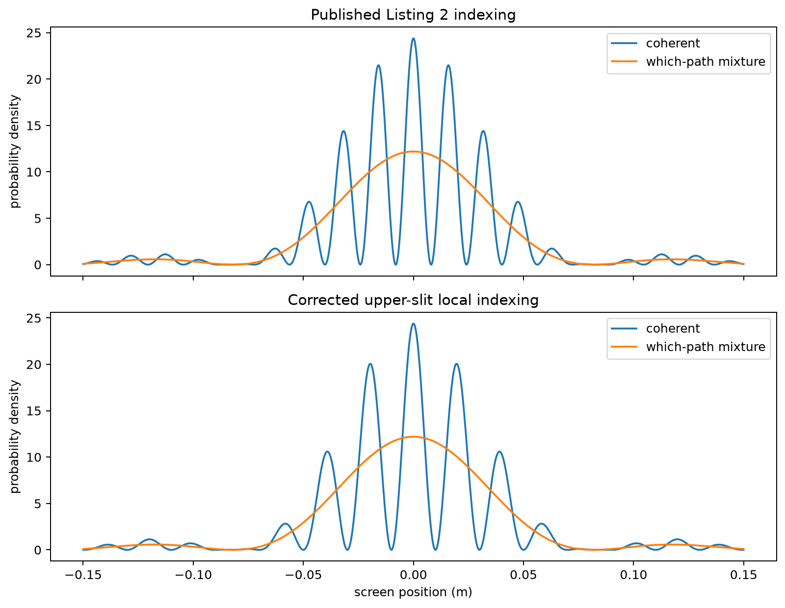

# Prior-work audit

Barandes's lecture notes and LeBlond's paper are direct predecessors to this
project, which replicates and extends their double-slit applications of
indivisible stochastic processes.

## Prior results

| Source | What it contributes | How this project uses it |
| --- | --- | --- |
| Jacob Barandes, *Double-Slit Interference for a Unistochastic Process*, Lecture Notes #22 | An explicit two-configuration unistochastic double-slit calculation, including cross terms and idealized which-path records. | Cited as the direct toy-model predecessor; the Hadamard example here specializes its general two-state algebra. The notes are linked, not redistributed, because the reviewed copy is all rights reserved. |
| David LeBlond, [*The electron double-slit experiment from an ISP perspective*](https://arxiv.org/abs/2511.02863) | A direct spatial extension to 2,000 sampled slit and screen positions, physical electron parameters, free-kernel quadrature, which-path cases, and complete R listings. | Reproduced in Python, audited below, and treated as the primary computational predecessor. |
| M. Bauer, [*On time and space double-slit experiments*](https://arxiv.org/abs/1304.1767) | A schematic analytic free-particle solution for point slits, relative phase, event buildup, and partial aperture weights. | Used as an analytic benchmark for the free phase and fringe shift. Its temporal-slit material is outside v1 scope. |
| Barandes, [*The Stochastic-Quantum Correspondence*](https://arxiv.org/abs/2302.10778), Section 3.5 | The general identity between interference and failure of stochastic divisibility. | Supplies the general derivation, rather than attributing that identity to this repository. |

## Extensions in this repository

1. A normalized, finite cyclic configuration space and a **complete unitary
   matrix**, not only the propagated amplitude of one initial wavefunction.
   Every column of $\Gamma=|U|^{\circ2}$ is verified stochastic.
2. An explicit implementation of the full
   $(\mathcal C,\mathcal T,\mathcal T_0,\Gamma,p,\mathcal A)$ tuple, with
   missing intermediate conditional laws rejected rather than inferred.
3. Quantitative direct-versus-divided residuals and invariants.
4. Two positive path-space realizers with identical one-time laws,
   making the nonuniqueness of trajectories executable.
5. A physical distinction between retained records, local reset, coherent
   global uncomputation, and postselected quantum erasure.
6. A finite real-barrier 2D calculation whose detector is time-integrated
   signed probability current, plus a quantitative transverse-law cross-check.
7. A numerical reproduction and correction of LeBlond's published upper-slit
   indexing.

Importing the free propagator is **not** counted as a defect. It is a principled
use of the Hilbert-space representation supplied by the stochastic-quantum
correspondence. Deriving the Hamiltonian independently from more primitive
stochastic assumptions would be a separate research objective.

## Audit of Barandes's Lecture Notes #22

The two-configuration cross-term calculation and the persistent-record result
are algebraically sound. The remaining issue is physical interpretation, not
algebra: the notes explicitly introduce the "forgetting" matrix as nonunitary,

$$
\Theta_E=
\begin{pmatrix}
1&1\\
0&0
\end{pmatrix}.
$$

It maps two orthogonal indicator configurations to the same vector. Therefore

$$
\Theta_E^\dagger\Theta_E
=\begin{pmatrix}
1&1\\
1&1
\end{pmatrix}\ne I,
$$

so it is not a unitary evolution of a closed two-state indicator. Its columns
are normalized, and it does define a valid many-to-one stochastic matrix within
the broader potential-matrix formalism. But it is not a trace-preserving quantum
reset channel when treated as a single Kraus operator.

A physical reset channel requires at least

$$
 K_0=|0\rangle\langle0|,\qquad
 K_1=|0\rangle\langle1|,
 \qquad K_0^\dagger K_0+K_1^\dagger K_1=I.
$$

Those alternatives sum at the probability/density-matrix level, not as one
coherent amplitude, and they do not restore electron interference. A local
unitary dilation moves the which-path record into a bath. Thus, if "forgetting"
is intended as a physical operation on a quantum record, the fringe-restoration
result requires either of two specifications:

- interpret the operation as a **global controlled uncomputation** that reverses
  the original marking interaction; or
- measure/postselect the record in a complementary basis, producing conditional
  fringe and antifringe patterns whose aggregate remains incoherent.

This does not challenge the unistochastic framework. It distinguishes a
nonunitary many-to-one local map from a physically specified erasure protocol.
The repository evaluates the four screen laws. For the local reset it uses the
reduced-state identity directly.

## Audit of LeBlond arXiv:2511.02863v1

### 1. Upper-slit indexing changes the physical geometry

Listing 2 loops over global R indices `ip = N/2+1, ..., N` for the upper slit,
but computes its coordinate as

```r
w <- (ip-1)*Delta_slit1 + Delta_slit1/2 + Zmin_slit1
```

without subtracting `N/2`. This translates the upper slit by one full slit
width, $1.5\times10^{-9}\thinspace \mathrm m$.

| Quantity | Intended/corrected | Published code |
| --- | ---: | ---: |
| lower center | $-3.075\times10^{-9}\thinspace \mathrm m$ | same |
| upper center | $+3.075\times10^{-9}\thinspace \mathrm m$ | $+4.575\times10^{-9}\thinspace \mathrm m$ |
| effective center separation | $6.15\times10^{-9}\thinspace \mathrm m$ | $7.65\times10^{-9}\thinspace \mathrm m$ |
| predicted $\lambda L/d_{\rm eff}$ | 0.0200 m | 0.01608 m |
| measured numerical spacing | 0.01950 m | 0.015825 m |

The published plot is therefore internally consistent with the geometry the
code actually evaluates, but not with the stated $d=6.15$ nm geometry or the
claimed 0.020 m fringe spacing. The corrected local index is

```r
w <- (ip-N/2-1)*Delta_slit1 + Delta_slit1/2 + Zmin_slit1
```



### 2. The plotted screen coordinate is shifted one bin

The calculation uses the stated midpoint coordinate

```r
x <- (i-1)*Delta_screen + Delta_screen/2 + Zmin_screen
```

but the plotting tibble uses

```r
x <- (1:N)*Delta_screen + Delta_screen/2 + Zmin_screen
```

which is larger by one screen bin, $1.5\times10^{-4}\thinspace \mathrm m$. This has no
effect on the computed amplitudes but shifts their displayed coordinates.

### 3. Continuum quadrature is not a normalized finite state vector

LeBlond's Eq. 4 calls

$$
  \Delta_{\rm slit}/\sqrt{2a}
$$

a discrete amplitude. In the code, however, `1/sqrt(2*a)` is an amplitude
density and `Delta_slit` is the midpoint quadrature weight multiplying the free
kernel. That continuum quadrature interpretation is coherent and gives about
95% probability inside the displayed screen interval, as the paper reports.

It is not a normalized coefficient in an ordinary finite Euclidean Hilbert
space: a normalized cell coefficient would scale as
$\sqrt{\Delta_{\rm slit}/(2a)}$. Correspondingly, the sampled continuum kernel
is not assembled and verified as an all-column finite unitary. The paper
computes one propagated continuum amplitude density; it does not by itself
construct a complete finite $\Gamma$ for all source configurations.

### 4. "Forgetting" needs a physical implementation

The `Forgets` branch routes both slit contributions to the same final qubit
label and adds them coherently. This reproduces the lecture-notes algebra, but
the listing does not establish that the full composite transition-amplitude
matrix is unitary. Read as a local reset of the qubit, it is not physical for
the reason above. Read as shorthand for a global controlled uncomputation, its
fringe-restoration result is valid. The repository uses the latter label rather
than leaving the operation ambiguous.
